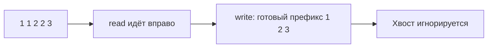

# Массивы и слайсы

Массив хранит элементы в последовательных позициях, поэтому обращение по известному индексу быстрое. Слайс Go описывает участок массива: начало, длину и доступную ёмкость. Два слайса могут смотреть на одни и те же элементы; изменение через один видно другому.

## Как обрабатывать без второго массива

При удалении ненужных элементов держат два индекса: `read` читает исходный участок, `write` отмечает следующую позицию ответа. Подходящий элемент записывают в `a[write]` и увеличивают `write`. В конце ответ — `a[:write]`, а не весь старый массив.

Для удаления дублей достаточно сравнивать соседние сохранённые значения **только в отсортированном массиве**. На `[1,2,1]` одинаковые значения не соседние; нужен набор уже встреченных значений или предварительная сортировка.

## Что проверить

Пустой вход, один элемент, все одинаковые, отсутствие удалений. Один проход занимает `O(n)` времени и `O(1)` дополнительной памяти. Вставка в середину массива сдвигает хвост и стоит `O(n)`, даже если найти позицию удалось быстро.

Сортировка и запись на месте меняют данные вызывающего. Если нужен независимый результат, создайте копию. Для структур с указателями очищайте ненужный хвост лишь при полном владении массивом; иначе измените чужой слайс.

## Разбор удаления дублей

Вход `[1,1,2,2,3]`, первая единица уже сохранена, `write=1`. Индекс `read=1` видит повтор — пропуск. На `read=2` найдено новое 2: пишем `a[1]=2`, теперь `write=2`. Следующая 2 пропускается, затем 3 записывается в `a[2]`. Ответ `a[:3]=[1,2,3]`; хвост массива больше не часть ответа.

Инвариант — утверждение, верное до и после каждого шага: a[:write] содержит ровно сохранённые элементы уже прочитанного участка. write никогда не правее read, поэтому запись не затирает ещё не прочитанные данные. Для неотсортированного входа соседнее сравнение недостаточно: используйте set либо сортировку с изменением порядка.

Если элементы содержат указатели, прежний хвост массива удерживает объекты. При полном владении можно очистить его через `clear(a[write:])`. Но другой слайс может использовать те же позиции, тогда очистка изменит его данные. Маленький слайс всё ещё держит большой исходный массив; для независимого маленького результата нужна копия.

## Проверь себя

1. **Почему write не должен идти правее read?**

   

   
Ответ

   Запись могла бы затереть элемент, который ещё не прочитан.

   

2. **Освобождает ли a[:write] хвост массива?**

   

   
Ответ

   Нет. Слайс сохраняет ссылку на исходный массив, включая удерживаемые в нём объекты.

   

