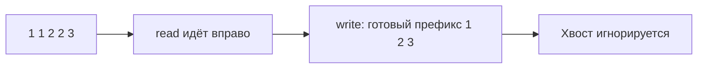

# Arrays и slices

Массив хранит элементы по индексам. Slice Go — описание участка массива: указатель, длина и ёмкость. Изменение элемента slice меняет общий массив, поэтому алгоритм «на месте» должен явно разрешаться условием.

## Что решает

Последовательный доступ, на месте transformation, compaction, partitioning и задачи, где порядок/индекс важнее lookup по key.

## Как распознать

Input contiguous, нужен один проход, разрешено менять массив, результат — prefix/segment или индекс. Часто достаточно индексы чтения и записи.

## Шаблон

```text
write = 0
for read in [0..n):
    if keep(a[read]):
        a[write] = a[read]
        write++
return a[:write]
```

Invariant: `a[:write]` уже содержит все сохранённые элементы из обработанного prefix в нужном порядке.

## Сложность

Один проход `O(n)` time, `O(1)` дополнительная память. Insert/delete в середине требует shift `O(n)`; append динамического массива — amortized `O(1)`.

## Типичные ошибки

Off-by-one, изменение length во время range, потеря общий backing array нескольких slices, удержание большого backing array маленьким subslice, integer overflow в index arithmetic.

## Несколько задач

- удалить duplicates из отсортированный slice на месте;
- move zeros с сохранением порядка;
- partition по predicate;
- rotate array;
- найти missing/duplicate при заданных constraints.

## Разбор удаления дублей

Вход [1,1,2,2,3]. write=1. read=1 видит повтор 1 — пропуск; read=2 видит 2 — записываем a[1]=2, write=2; read=3 повтор 2; read=4 записывает a[2]=3. Результат a[:3]=[1,2,3], хвост массива не относится к ответу.



Инвариант — утверждение, верное до и после каждого шага: a[:write] содержит ровно сохранённые элементы уже прочитанного участка. write никогда не правее read, поэтому запись не затирает ещё не прочитанные данные. Для неотсортированного входа соседнее сравнение недостаточно: используйте set либо сортировку с изменением порядка.

Если элементы содержат указатели, старый хвост удерживает объекты: после compaction при полном владении массивом можно clear(a[write:]). Если другой slice использует хвост, такая очистка меняет его данные. Сам алгоритм не освобождает большой backing array; для независимого маленького результата нужна копия.

## Проверь себя

1. **Почему write<=read важно?**

   <details>
   <summary>Ответ</summary>

   Иначе запись может затереть непрочитанный элемент.

   </details>

2. **Почему a[:write] не освобождает хвост массива?**

   <details>
   <summary>Ответ</summary>

   Slice всё ещё ссылается на backing array; GC учитывает его ссылки.

   </details>
