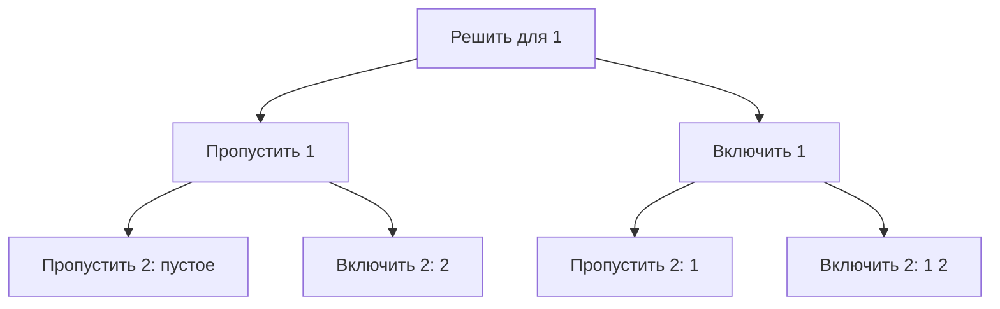

# Перебор с возвратом

Перебор с возвратом (backtracking) строит ответ по частям: выбирает вариант, исследует продолжения и отменяет выбор перед следующим вариантом. Так обходят дерево решений. Метод нужен для перечисления комбинаций и задач, где безопасность одного локального выбора не доказана.

## Все подмножества

У каждого элемента два решения: включить или пропустить. Для [1,2] получаем [],[2],[1],[1,2] при обходе сначала ветви пропуска.



```go
func subsets(a []int) [][]int {
	out := make([][]int, 0)
	path := make([]int, 0, len(a))
	var visit func(int)
	visit = func(index int) {
		if index == len(a) {
			snapshot := append([]int(nil), path...)
			out = append(out, snapshot)
			return
		}
		visit(index + 1)
		path = append(path, a[index])
		visit(index + 1)
		path = path[:len(path)-1]
	}
	visit(0)
	return out
}
```

Инвариант входа `visit(index)`: path содержит выборы только из `a[:index]`. После каждой ветви path возвращается в прежнее состояние. Создание независимой копии обязательно: сохранение одного path без копии даст результаты, ссылающиеся на переиспользуемый массив. Для пустого входа есть одно подмножество — пустое, а не ноль ответов.

Каждый из n элементов участвует в половине из 2ⁿ ответов. Вывод с копиями требует O(n·2ⁿ) времени и общей памяти результата; рабочие path и стек O(n). При n=30 количество подмножеств уже больше миллиарда. Нельзя обещать быстрый полный вывод только из-за аккуратного рекурсивного обхода.

## Отсечение и дубли

Отсечение прекращает ветвь, если **доказано**, что она не даст нужного ответа. Для суммы положительных чисел pathSum>target позволяет остановку; с отрицательными числами такое отсечение неверно. Верхняя оценка качества может отсечь ветвь оптимизации, если она не лучше уже найденного результата.

При входе [1,1] код перечисляет подмножества **позиций** и выдаст два одинаковых [1]. Если нужны уникальные наборы значений, сортируют входные данные и пропускают равные варианты на одном уровне выбора; условие зависит от формы дерева. Глобальное «никогда не брать одинаковое значение» ошибочно исключит [1,1].

Запоминание подзадач, memoization, объединяет состояния лишь тогда, когда будущий ответ полностью определяется сохранённым ключом. Для проверки существования суммы `(index,sum)` может подойти; для перечисления разных путей такое объединение способно потерять ответы. В сервисе ограничивайте глубину, число результатов и время, а отмену проверяйте в самом обходе. Реализация и проверки: [учебный модуль](examples/README.md).

## Связанные темы

- [Поиск в ширину и глубину: BFS и DFS](bfs-and-dfs.md) — обход дерева решений.
- [DP](dynamic-programming.md) — переиспользование ответов одинаковых подзадач.
- [Сложность](complexity.md) — стоимость полного результата.

## Проверь себя

1. **Почему path копируют при сохранении ответа?**

   <details>
   <summary>Ответ</summary>

   Рабочий слайс переиспользует массив. Следующая ветвь без копии изменила бы уже сохранённый ответ.

   </details>

2. **Можно ли отсечь слишком большую сумму при отрицательных числах?**

   <details>
   <summary>Ответ</summary>

   Нет. Следующий отрицательный элемент способен уменьшить сумму.

   </details>

3. **Почему запоминание только index и sum может потерять перечисляемые ответы?**

   <details>
   <summary>Ответ</summary>

   Одно состояние достигается разными путями. Для перечисления каждый путь может быть отдельным нужным ответом.

   </details>
