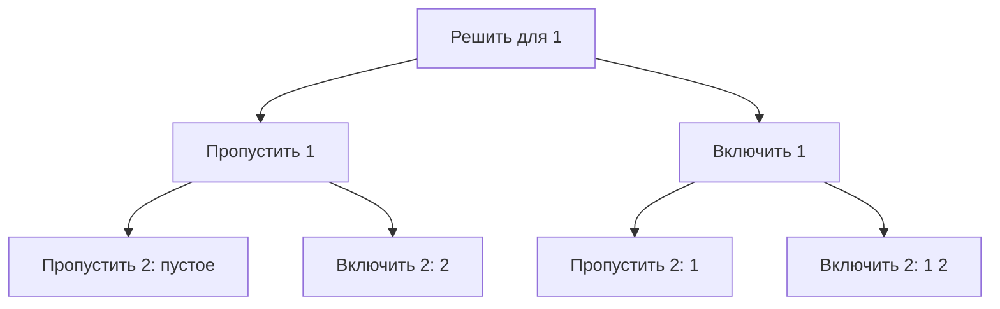

# Перебор с возвратом

Backtracking строит ответ по частям: выбирает вариант, исследует продолжения и отменяет выбор перед следующим вариантом. Это обход дерева решений. Метод нужен для перечисления комбинаций, ограничений и задач, где безопасный локальный выбор не доказан.

## Все подмножества

У каждого элемента два решения: включить или пропустить. Для [1,2] получаем [],[2],[1],[1,2] при обходе сначала ветви пропуска.



```go
func subsets(a []int) [][]int {
	out := make([][]int, 0)
	path := make([]int, 0, len(a))
	var visit func(int)
	visit = func(index int) {
		if index == len(a) {
			snapshot := append([]int(nil), path...)
			out = append(out, snapshot)
			return
		}
		visit(index + 1)
		path = append(path, a[index])
		visit(index + 1)
		path = path[:len(path)-1]
	}
	visit(0)
	return out
}
```

Инвариант входа `visit(index)`: path содержит выборы только из `a[:index]`. После каждой ветви path возвращается в прежнее состояние. Создание независимой копии обязательно: сохранение одного path без копии даст результаты, ссылающиеся на переиспользуемый массив. Для пустого входа есть одно подмножество — пустое, а не ноль ответов.

Каждый из n элементов участвует в половине из 2ⁿ ответов. Вывод с копиями требует O(n·2ⁿ) времени и общей памяти результата; рабочие path и стек O(n). При n=30 количество подмножеств уже больше миллиарда. Нельзя обещать быстрый полный вывод только из-за аккуратного рекурсивного обхода.

## Отсечение и дубли

Отсечение прекращает ветвь, если **доказано**, что она не даст нужного ответа. Для суммы положительных чисел pathSum>target позволяет остановку; с отрицательными числами такое отсечение неверно. Верхняя оценка качества может отсечь ветвь оптимизации, если она не лучше уже найденного результата.

При входе [1,1] код перечисляет подмножества **позиций** и выдаст два одинаковых [1]. Если нужны уникальные наборы значений, сортируют входные данные и пропускают равные варианты на одном уровне выбора; условие зависит от формы дерева. Глобальное «никогда не брать одинаковое значение» ошибочно исключит [1,1].

Memoization объединяет состояния только если дальнейшие ответы действительно зависят от сохранённого ключа. Для поиска существования подходящей суммы ключ `(index,sum)` может подойти; для полного перечисления разных path он может потерять ответы. В рабочей среде ограничивайте количество результатов, глубину и время; отмена требует проверки context в обходе. Реализация и проверки: [examples](examples/README.md).

## Связанные темы

- [DFS](bfs-and-dfs.md) — обход дерева решений.
- [DP](dynamic-programming.md) — переиспользование ответов одинаковых подзадач.
- [Сложность](complexity.md) — стоимость полного результата.

## Проверь себя

1. **Почему нужно копировать path при сохранении ответа?**

   <details>
   <summary>Ответ</summary>

   path переиспользует backing array; следующие ветви меняют прежние ответы без копии.

   </details>

2. **Можно отсечь pathSum>target при отрицательных значениях?**

   <details>
   <summary>Ответ</summary>

   нет, следующий отрицательный элемент способен уменьшить сумму.

   </details>

3. **Почему memo(index,sum) может быть опасно для перечисления?**

   <details>
   <summary>Ответ</summary>

   одинаковое состояние может достигаться разными путями, каждый из которых нужен в результате.

   </details>
