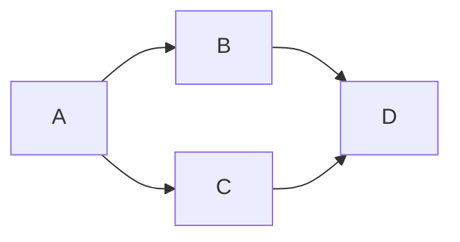

# Поиск в ширину и глубину: BFS и DFS

Граф — вершины и связи между ними. Обход отвечает, куда можно добраться из начальной вершины. Важно помечать посещённые состояния: без этого цикл A → B → A никогда не закончится.

## Два способа обхода

**BFS**, поиск в ширину, использует очередь. Сначала исследует соседей на расстоянии одного перехода, затем двух и так далее. Поэтому первый приход в вершину даёт кратчайшее число переходов, если все рёбра стоят одинаково. Отмечайте вершину при добавлении в очередь, чтобы разные соседи не добавили её несколько раз.

**DFS**, поиск в глубину, идёт по одной ветви до конца, затем возвращается. Рекурсивные вызовы или явный стек хранят путь возврата. DFS удобен для исследования связности, дерева решений и циклов, но первый найденный путь обычно не кратчайший.

## Сколько работы

При списках соседей каждую доступную вершину и ребро рассматривают ограниченное число раз: `O(V+E)`, где V — вершины, E — рёбра. Посещённые вершины и очередь/стек требуют до `O(V)` памяти. Для матрицы смежности проверка всех возможных соседей может требовать `O(V²)`.

Глубокая цепочка может переполнить доступный стек рекурсии. Явный стек позволяет контролировать память, но не делает весь обход бесплатным. Если состояние включает ключи или остаток ресурса, посещение только по координате может быть неверным.

## Одно ребро — один шаг

Очередь BFS сначала `[A]`, затем `[B,C]`, затем `[C,D]`. D помечается при добавлении из B, поэтому C не добавит его второй раз. Расстояния: A=0, B=C=1, D=2. Если помечать лишь при извлечении, оба предшественника успеют добавить D; в большом графе число повторов вырастет.

Для поиска цикла в направленном графе DFS различает: ещё не посещён, сейчас в пути, полностью обработан. Ребро к вершине текущего пути замыкает цикл; к уже законченной — само по себе нет. В ненаправленном графе обратное ребро к родителю не считается циклом. При параллельных рёбрах различайте номера рёбер, а не только родителя.

Посещённое состояние включает всё, что меняет возможные продолжения. В лабиринте с ключами это `(строка,колонка,набор ключей)`. Ранний приход без ключа не должен запретить полезный повтор с ключом. При разной цене рёбер BFS минимизирует переходы, не суммарную стоимость.

## Проверь себя

1. **Почему BFS отмечает вершину при добавлении в очередь?**

   

   
Ответ

   Это предотвращает несколько добавлений и фиксирует первый кратчайший приход по числу переходов.

   

2. **Почему в лабиринте с ключами недостаточно посещения по координатам?**

   

   
Ответ

   Одна клетка с разными наборами ключей имеет разные возможные продолжения.

   

