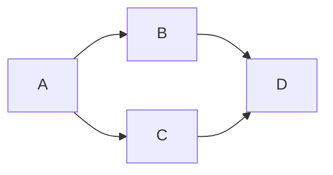

# BFS и DFS

BFS идёт слоями по расстоянию от старта, DFS углубляется по одному пути. Без весов первый приход BFS даёт минимальное число переходов.

## Что решает

Reachability, connected components, flood fill, cycle/topological analysis и paths. BFS на unweighted graph находит shortest number of edges; DFS удобен для structure/postorder.

## Как распознать

Есть states и transitions/neighbors; нужно посетить reachable set или найти путь. State может быть implicit: grid cell, word, configuration.

## Шаблон

BFS использует queue и mark on enqueue. DFS использует recursion или explicit stack; для cycle в directed graph нужны состояния unseen/visiting/done.

## Сложность

Adjacency-list traversal `O(V+E)` time, `O(V)` visited/frontier. Grid `O(rows×cols)`. Если neighbors генерируются дорого, включайте их стоимость.

## Типичные ошибки

Не включить весь state в visited key; mark после dequeue/push и получить duplicates; DFS recursion overflow; применять BFS к weighted edges; забыть disconnected components; mutate input, когда это запрещено.

## Несколько задач

- islands/flood fill;
- shortest grid path;
- clone graph;
- course schedule/cycle;
- multi-source BFS от всех источников.

## Одно ребро — один шаг

BFS queue сначала[A], затем[B,C], затем[C,D]. D отмечается при добавлении изB, поэтому изC не добавляется второй раз. dist(A)=0, dist(B)=dist(C)=1, dist(D)=2. Если отмечать лишь при извлечении, оба parent добавятD; на больших графах число дублей возрастает.

Для directed cycle DFS использует white/gray/black: ребро к gray означает возврат в текущий путь, ребро к black само по себе не цикл. Для undirected graph обратное ребро к parent не считается циклом; multigraph с параллельными рёбрами требует различать edge ID, а не просто имя parent.

Состояние visited должно включать всё влияющее на дальнейшие переходы. На grid с ключами state=(row,column,keyMask), иначе ранний приход без ключа заблокирует полезный повтор. С weighted edges BFS по числу переходов не минимизирует стоимость.

## Проверь себя

1. **Почему mark on enqueue?**

   

   
Ответ

   Не допускает многократную постановку одного состояния и фиксирует первый shortest distance.

   

2. **Почему visited только по координатам недостаточно для maze с ключами?**

   

   
Ответ

   Одна клетка с разным набором ключей имеет разные доступные следующие шаги.

   

