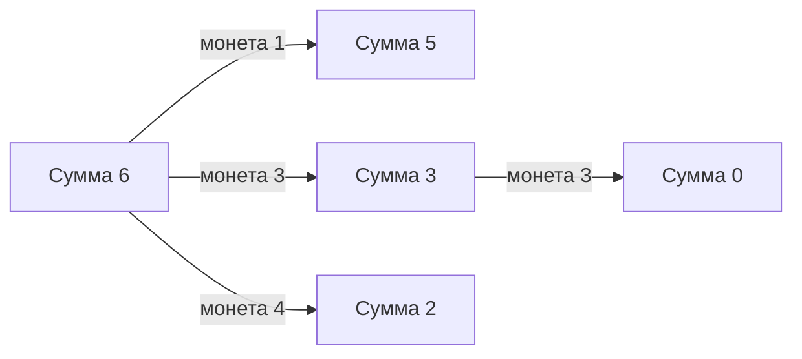

# Динамическое программирование

Динамическое программирование (DP) сохраняет ответы маленьких подзадач и использует их для большого ответа. Оно помогает, когда одни подзадачи повторяются, а оптимальный ответ можно получить из оптимальных ответов меньших задач. Таблица сама по себе не делает решение правильным: нужно определить её смысл и переход.

## Монеты: почему greedy не хватает

Даны положительные номиналы [1,3,4], каждого неограниченно; сумма 6. Выбор самой большой монеты даёт 4+1+1, но 3+3 лучше. Пусть dp[s] — минимальное число монет для **точной** суммы s. База dp[0]=0. Для каждой монеты c<=s возможен ответ dp[s-c]+1; берём минимум среди достижимых вариантов.

| s | 0 | 1 | 2 | 3 | 4 | 5 | 6 |
| --- | --- | --- | --- | --- | --- | --- | --- |
| dp[s] | 0 | 1 | 2 | 1 | 1 | 2 | 2 |



Доказательство: последняя монета любого решения имеет некоторый номинал c; оставшиеся монеты дают s-c. Если они не оптимальны, заменяем их лучшим решением. Перебор последнего c покрывает все варианты.

## Код Go

Контракт: amount>=0, номиналы строго положительные; отрицательная сумма или некорректный номинал возвращают -1. Число amount определяет объём выделяемой памяти, поэтому вызывающий задаёт допустимый верхний предел. Возвращаем -1, если точная сумма недостижима.

```go
func minCoins(coins []int, amount int) int {
	if amount < 0 {
		return -1
	}
	for _, coin := range coins {
		if coin <= 0 {
			return -1
		}
	}
	dp := make([]int, amount+1)
	for sum := 1; sum <= amount; sum++ {
		dp[sum] = -1
		for _, coin := range coins {
			if coin <= sum && dp[sum-coin] >= 0 {
				candidate := dp[sum-coin] + 1
				if dp[sum] < 0 || candidate < dp[sum] {
					dp[sum] = candidate
				}
			}
		}
	}
	return dp[amount]
}
```

minCoins([1,3,4],6)=2; minCoins([2],3)=-1; amount0 даёт0. Таблица строится по возрастанию суммы: все зависимости уже известны. Для k номиналов и суммы S время O(kS), память O(S). Это псевдополиномиальная сложность: S — значение числа, не длина его записи; огромная сумма непригодна для такой таблицы.

Чтобы восстановить набор монет, храните chosenCoin[s] при улучшении и двигайтесь s-=chosenCoin[s]. Если каждую монету можно использовать только один раз, это другая задача: одномерную таблицу часто обходят по сумме **вниз**, чтобы текущий предмет не использовался повторно. Для подсчёта комбинаций и последовательностей порядок внешнего цикла также меняет результат.

Top-down memoization считает только востребованные состояния, но использует стек рекурсивных вызовов. Bottom-up явно задаёт порядок и легче ограничивает память. Сокращение таблицы допустимо только если уже посчитанные значения не будут нужны позже. Рабочая реализация и проверки: [examples](examples/README.md).

## Источники

- [MIT 6.006: лекции 15–18 о dynamic programming](https://ocw.mit.edu/courses/6-006-introduction-to-algorithms-spring-2020/pages/lecture-notes/)

## Проверь себя

1. **Как определить состояние, прежде чем писать циклы?**

   <details>
   <summary>Ответ</summary>

   точно сформулировать, какой ответ хранится для индекса и какие данные будущего влияют на него; затем база и переход.

   </details>

2. **Почему обход суммы вверх меняется для 0/1 knapsack?**

   <details>
   <summary>Ответ</summary>

   обновлённое меньшей суммой значение может уже содержать текущий предмет; повторное использование нарушит ограничение один раз.

   </details>

3. **O(kS) всегда быстро для большого S?**

   <details>
   <summary>Ответ</summary>

   нет, сложность зависит от численного значения суммы, а память O(S); надо учитывать лимиты входа.

   </details>
