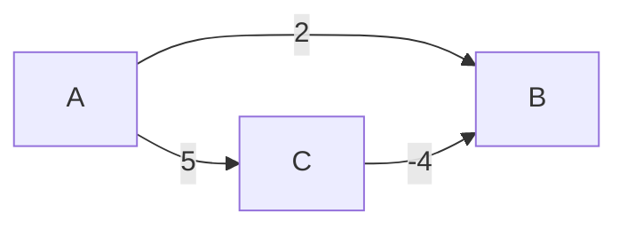

# Graphs

Граф описывает связи между объектами. Перед алгоритмом определите направление, веса, наличие отрицательных рёбер и способ хранения соседей.

## Что решает

Связи many-to-many: routing, dependencies, connectivity, prerequisites, networks и state spaces.

## Как распознать

Entities — vertices, relations/transitions — edges; path/cycle/component/order важнее hierarchy. Определите directed/undirected, weighted, negative weights, sparse/dense.

## Шаблон

- adjacency list для sparse graph;
- BFS для unweighted shortest path;
- Dijkstra с min-heap для non-negative weights;
- topological sort для DAG dependencies;
- Union-Find для incremental undirected connectivity.

## Сложность

BFS/DFS `O(V+E)`. Dijkstra adjacency list + heap `O((V+E) log V)`. Topological `O(V+E)`. Union-Find amortized почти constant (`O(α(V))`).

## Типичные ошибки

Забыть обратное edge в undirected graph; Dijkstra с negative weight; overflow distance; не отбросить stale heap entry; topology вернуть partial order при cycle; путать node label с dense index.

## Несколько задач

- network delay;
- dependency ordering;
- connected components;
- minimum spanning tree;
- evaluate paths/state transitions.

## Dijkstra и отрицательное ребро

A→B=2, A→C=5, C→B=-4. Если алгоритм окончательно фиксирует B с distance2 до обхода C, он пропустит путь A→C→B стоимость1. Условие неотрицательных весов нужно для доказательства, не только оптимизации.

Для Dijkstra без decrease-key кладут новую пару distance/node после улучшения и игнорируют извлечённую устаревшую пару. Куча может хранить O(E) записей; оценка O((V+E)logV) обычно подразумевает обычный простой граф и heap assumptions. Указывайте вариант реализации.

Topological sort Kahn: положить vertices с indegree0, снять, уменьшить indegree соседей. Граф A→C,B→C даёт A,B,C или B,A,C; порядок не уникален. Если обработано меньше V, есть cycle и частичный список нельзя объявлять полным расписанием. Union-Find подходит undirected connectivity, не доказывает направление reachability. Path compression и rank/size дают амортизированную α(V).

## Проверь себя

1. **Почему Dijkstra не допускает отрицательные веса?**

   

   
Ответ

   Фиксация ближайшей вершины перестаёт быть доказуемо окончательной.

   

2. **Как Kahn обнаруживает cycle?**

   

   
Ответ

   При cycle не все V vertices будут извлечены после истощения очереди indegree0.

   

