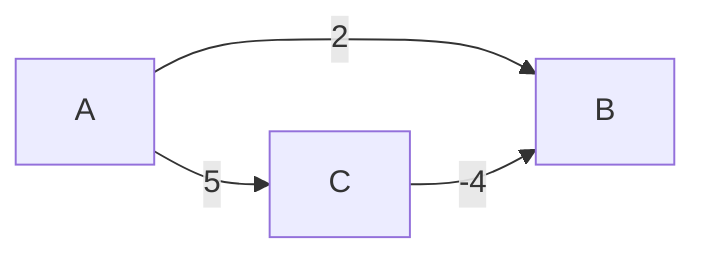

# Графы

Граф описывает объекты и связи: города и дороги, задачи и зависимости. Сначала определите, направлены ли связи, есть ли стоимость перехода и могут ли повторяться рёбра. От этого зависит алгоритм.

## Представление

Список соседей хранит только существующие связи и занимает `O(V+E)`. Матрица позволяет быстро проверить конкретную пару, но требует `O(V²)` памяти. Для ненаправленного графа ребро обычно добавляют в обе стороны; это не происходит автоматически.

## Какую задачу решаем

[Поиск в ширину и глубину: BFS и DFS](bfs-and-dfs.md) ищет минимальное число переходов при одинаковой цене рёбер. Dijkstra выбирает ещё не обработанную вершину с минимальной найденной стоимостью и улучшает пути к её соседям. Его доказательство требует неотрицательных весов: отрицательное ребро может позже улучшить уже зафиксированный ответ.

Топологическая сортировка упорядочивает задачи так, чтобы зависимости шли раньше. Алгоритм Kahn начинает с вершин без входящих рёбер, удаляет их и уменьшает число зависимостей соседей. Если не удалены все вершины, есть цикл и полного расписания не получилось.

Union-Find хранит объединения компонент и быстро отвечает, связаны ли вершины ненаправленного графа. Он не отвечает, существует ли направленный путь. Сжатие путей и объединение по размеру дают очень медленно растущую амортизированную стоимость.

Не переносите гарантию одного алгоритма на все графы: направления, отрицательные веса и состав состояния меняют задачу.

## Dijkstra и отрицательное ребро

A→B=2, A→C=5, C→B=-4. Если алгоритм окончательно фиксирует B с distance2 до обхода C, он пропустит путь A→C→B стоимость1. Условие неотрицательных весов нужно для доказательства, не только оптимизации.

В Dijkstra можно обойтись без изменения приоритета существующего элемента: после улучшения добавить новую пару «расстояние, вершина», а старую пропустить при извлечении. Тогда в куче может лежать до `O(E)` записей. Оценка `O((V+E)log V)` обычно относится к простому графу и соответствующим предположениям о куче; называйте свой вариант реализации.

Для A→C и B→C подходят порядки A,B,C или B,A,C: ответ не обязательно единственный. Если Kahn обработал меньше V вершин, очередь исчерпалась из-за цикла, а частичный список не является полным расписанием. Union-Find проверяет ненаправленную связность, не направление пути; сжатие путей и объединение по размеру дают амортизированную оценку α(V).

## Проверь себя

1. **Почему Dijkstra требует неотрицательных весов?**

   

   
Ответ

   Иначе поздний путь может улучшить уже зафиксированную ближайшую вершину.

   

2. **Как Kahn обнаруживает цикл?**

   

   
Ответ

   После исчерпания очереди вершин без входящих рёбер обработано меньше V вершин.

   

