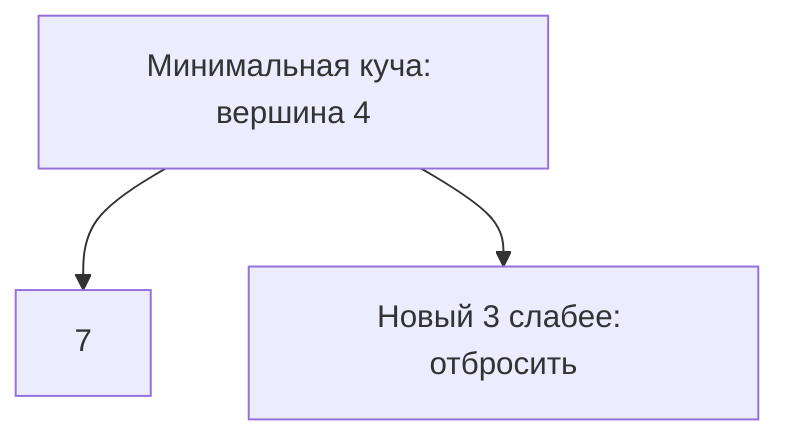

# Куча и приоритеты

Куча — структура, которая быстро выдаёт лучший элемент по выбранному приоритету. В минимальной куче родитель не больше детей, поэтому минимум всегда наверху. Остальной массив не отсортирован целиком.

## Что происходит при изменении

Новый элемент добавляют в конец и поднимают, пока порядок не восстановится. При извлечении вершину заменяют последним элементом и опускают. Эти операции проходят высоту дерева: `O(log n)`. Посмотреть вершину можно за `O(1)`, построить кучу из готового массива — за `O(n)`.

Для K самых больших значений храните минимальную кучу из K кандидатов. Слабейший кандидат находится наверху: при переполнении его удобно удалить. Для n входных значений это `O(n log K)` при K>0 и `O(K)` дополнительной памяти.

## Условия интерфейса Go

`container/heap` вызывает ваши методы `Len`, `Less`, `Swap`, `Push`, `Pop`; обычный метод `Pop` структуры удаляет последний элемент, а выбор вершины выполняет пакет. Изменив приоритет уже лежащего элемента, вызывайте `heap.Fix` с его текущим индексом. При перестановке обновляйте сохранённые индексы.

Куча не обещает порядок равных приоритетов. Если он нужен, добавьте явное сравнение по уникальному номеру. K=0 обработайте отдельно; извлечение из пустой кучи недопустимо.

## Два наибольших на числах

Вход `[4,1,7,3]`, нужны два наибольших. После 4 куча `[4]`, после 1 — `[1,4]`. Добавление 7 даёт три кандидата: удаляем минимум 1, остаются 4 и 7. Добавление 3 снова переполняет кучу, удаляем 3. Ответ содержит 4 и 7, но внутренний массив не обязательно отсортирован.

После каждого элемента куча хранит до K самых больших из уже прочитанных. Построение готовой кучи снизу стоит `O(n)`: большинство узлов расположено низко и опускается недалеко. Поочерёдное добавление n элементов имеет другую оценку `O(n log n)`. В Go библиотечный `heap.Pop` сначала переносит минимум в конец; прямой вызов вашего метода `Pop` не заменяет эту операцию.

После изменения приоритета порядок восстанавливает `heap.Fix`; `Swap` должен обновлять индексы. При K=0 сразу возвращайте пустой результат. Если важен порядок равных приоритетов, добавьте дополнительный ключ сравнения: сама куча его не задаёт.

## Проверь себя

1. **Почему для K наибольших кандидатов нужна минимальная куча?**

   

   
Ответ

   Наверху слабейший выбранный кандидат, который удаляется при превышении K.

   

2. **Зачем heap.Fix после изменения приоритета?**

   

   
Ответ

   Изменение поля не восстанавливает отношения в куче. Fix исправляет соответствующий путь.

   

