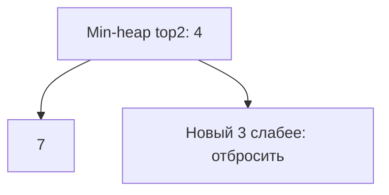

# Heap

Куча быстро отдаёт минимум или максимум, но не сортирует весь массив. Для K наибольших элементов удобно хранить K кандидатов с самым слабым на вершине.

## Что решает

Repeated extract-min/max, bounded Top K, scheduler priority, k-way merge и streaming median с двумя heaps.

## Как распознать

Нужен лучший элемент после динамических insertions; сортировать всё избыточно; одновременно важны только K candidates.

## Шаблон

Top K largest держит min-heap размера K:

```text
for x in input:
    push x
    if heap.size > K: pop minimum
```

После прохода heap содержит K largest, но не обязательно sorted.

## Сложность

Build heap `O(n)`, push/pop `O(log k)`, peek `O(1)`. Top K — `O(n log k)` time, `O(k)` space; full output sorting добавит `O(k log k)`.

## Типичные ошибки

Выбрать max-heap вместо min-heap для bounded top largest; считать internal array sorted; mutate priority без fix; comparator overflow через subtraction; не определить tie-breaker/stability.

## Несколько задач

- Kth largest;
- merge K sorted lists;
- top K frequent;
- meeting-room scheduler;
- running median.

## Top-2 на числах

Поток[4,1,7,3]. После4 куча[4]; после1 [1,4]; добавляем7 и удаляем minimum1 → остаются4,7; добавляем3, удаляем3 → ответ4,7. Внутренний порядок массива не обязан совпадать с отсортированным ответом.



Инвариант: после каждого элемента куча содержит до K наибольших из увиденных. Build-heap O(n) не равен n последовательным pushes O(n log n): нижние узлы требуют мало sift-down. В Go Pop метода heap.Interface удаляет последний элемент структуры; библиотечный heap.Pop сначала переставляет minimum в конец. Вызов вашего h.Pop напрямую не извлечёт minimum правильно.

При изменении priority используйте heap.Fix с сохранённым индексом; Swap обязан обновлять индексы. Для K=0 немедленно возвращайте пустой результат: log0 в формуле не имеет смысла. Equal priorities требуют явного tie-breaker, если контракт обещает deterministic order.

## Проверь себя

1. **Почему bounded Top K largest использует min-heap?**

   <details>
   <summary>Ответ</summary>

   Вершина — слабейший кандидат, его удобно удалить при превышении K.

   </details>

2. **Зачем heap.Fix после изменения priority?**

   <details>
   <summary>Ответ</summary>

   Изменение поля само не восстанавливает порядок кучи; Fix перестраивает путь.

   </details>
