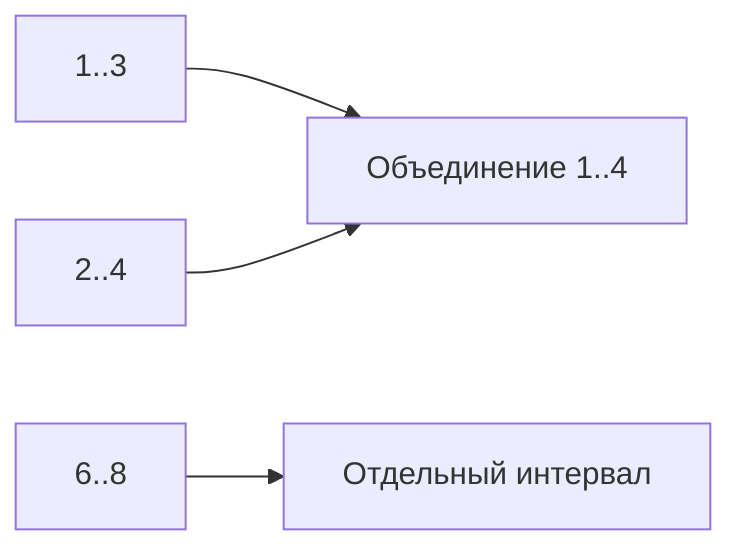

# Intervals

Интервал имеет начало, конец и правило включения границ. Оно определяет, пересекаются ли встречи, где одна заканчивается ровно в момент начала другой.

## Что решает

Merge overlaps, scheduling conflicts, coverage, resource concurrency и line sweep events.

## Как распознать

Input состоит из start/end, важен overlap/union; sorting по start превращает global problem в сравнение с последним merged interval.

## Шаблон

```text
sort by (start, end)
for interval:
    if result empty or interval.start > result.last.end:
        append interval
    else:
        result.last.end = max(last.end, interval.end)
```

Условие меняется для closed `[a,b]` и полуоткрытый `[a,b)`: touching intervals могут overlap или нет по domain.

## Сложность

Sorting `O(n log n)`, merge `O(n)`, output `O(n)`. Уже отсортированный вход — `O(n)`.

## Типичные ошибки

Не определить endpoint semantics/timezone; сортировать только start без нужного tie-break; mutate aliased input неожиданно; overflow при event comparator; обрабатывать equal start/end в неверном порядке sweep line.

## Несколько задач

- merge intervals;
- insert interval;
- meeting rooms count;
- total covered length;
- employee free time.

## Слияние и количество комнат

Закрытые [1,3],[2,4],[6,8] после sort: первый ответ[1,3]; второй пересекает его, конец растёт до4; третий начинает новый. Итог[1,4],[6,8]. Инвариант: ответ упорядочен, непересекающиеся завершённые интервалы больше не изменяются, последний содержит объединение текущей группы.

Для встреч [10,11) и [11,12) нужна одна комната, не две. Sweep line обрабатывает конец в11 до начала в11. Для закрытых интервалов, где обе точки включены, политика событий меняется. Пустой [a,a) не занимает ресурсы.



Не переводите полуоткрытый в closed через end-1 для непрерывного времени. Время храните с определённой timezone; локальная дата при смене часового пояса не всегда соответствует фиксированной длине суток. Условие Start>End должно отклоняться или иметь явно заданный смысл, а сортировка меняет input.

## Проверь себя

1. **Встречи [1,2) и [2,3) пересекаются?**

   <details>
   <summary>Ответ</summary>

   Нет: точка2 входит только во вторую.

   </details>

2. **Зачем сортировка перед merge?**

   <details>
   <summary>Ответ</summary>

   Каждый новый интервал может конфликтовать только с последней объединённой группой.

   </details>
