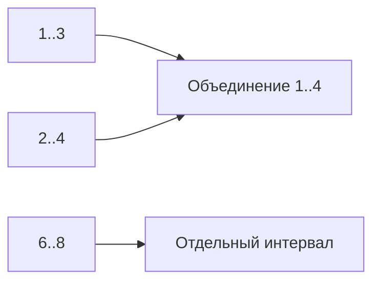

# Интервалы

Интервал задаёт участок между началом и концом. Сначала уточните границы: `[1,2]` включает 2, `[1,2)` — нет. От этого зависит, пересекаются ли встречи, заканчивающиеся и начинающиеся в одно время.

## Как объединить пересечения

Отсортируйте интервалы по началу. Держите последний объединённый интервал. Если следующий пересекает его, расширьте конец до максимального; если нет — начните новую группу. Благодаря сортировке новый интервал уже не сможет затронуть более раннюю завершённую группу.

Сортировка стоит `O(n log n)`, проход `O(n)`, результат до `O(n)` памяти. Сортировка на месте меняет вход, поэтому копия нужна, если вызывающий должен сохранить прежний порядок.

## Как посчитать одновременные встречи

Превратите начало в событие +1, конец в -1 и пройдите события по времени. Максимум счётчика — число нужных комнат. Для полуоткрытых интервалов конец при одинаковом времени обрабатывается раньше начала; иначе одна освобождённая комната ошибочно считается ещё занятой.

Пустой `[a,a)` не занимает ресурсы. Начало больше конца должно иметь явно заданную ошибку или специальный смысл. Не превращайте непрерывное время в закрытый интервал вычитанием единицы: единица зависит от точности, а смысл границы другой.

## Слияние и количество комнат

Закрытые [1,3],[2,4],[6,8] после sort: первый ответ[1,3]; второй пересекает его, конец растёт до4; третий начинает новый. Итог[1,4],[6,8]. Инвариант: ответ упорядочен, непересекающиеся завершённые интервалы больше не изменяются, последний содержит объединение текущей группы.

Для встреч [10,11) и [11,12) нужна одна комната, не две. Sweep line обрабатывает конец в11 до начала в11. Для закрытых интервалов, где обе точки включены, политика событий меняется. Пустой [a,a) не занимает ресурсы.

Не преобразуйте непрерывный полуоткрытый интервал в закрытый через `end-1`: единица времени и смысл границы различаются. Зафиксируйте часовой пояс; календарные сутки при переводе часов не всегда имеют одну длительность. Неверное `Start>End` должно быть отклонено или явно определено, а сортировка изменяет вход.

## Проверь себя

1. **Пересекаются ли [1,2) и [2,3)?**

   

   
Ответ

   Нет. Точка 2 входит только во второй.

   

2. **Почему перед объединением сортируют по началу?**

   

   
Ответ

   Очередной интервал может затронуть только последнюю незавершённую группу, не более ранние.

   

