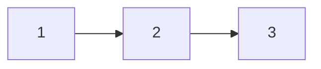

# Linked lists

Связный список хранит переход к следующему узлу. Быстрой вставка становится только когда уже известен нужный узел; поиск позиции по индексу остаётся линейным.

## Что решает

Pointer rewiring, O(1) insertion with known node, cycle/middle detection и merge sorted streams.

## Как распознать

Random access не нужен; задача требует изменить links на месте; slow/fast pointers дают distance/cycle relation.

## Шаблон

Reverse:

```text
prev = nil; cur = head
while cur != nil:
    next = cur.next
    cur.next = prev
    prev = cur
    cur = next
return prev
```

Sentinel dummy упрощает delete/merge у head.

## Сложность

Traversal/reversal `O(n)` time, `O(1)` space. Access by index `O(n)`. Recursive reverse использует `O(n)` stack.

## Типичные ошибки

Потерять `next` до rewiring; не обновить head/tail; cycle вызвать infinite loop; сравнивать values вместо node identity; оставить broken prev/next в doubly list.

## Несколько задач

- reverse list;
- detect cycle и entry;
- merge sorted lists;
- remove Nth from end;
- LRU: hash map + doubly linked list.

## Разворот 1 → 2 → 3



Шаг1: сохранить next=2, направить1 на nil, prev=1, cur=2. Шаг2: сохранить3, направить2 на1, prev=2. Шаг3: сохранитьnil, направить3 на2. Итог3→2→1. Инвариант: prev — уже развёрнутый префикс, cur — начало ещё не обработанного суффикса. Если переписать cur.Next до сохранения next, потеряется остаток.

Цикл slow/fast: slow проходит один переход, fast два. В цикле их относительное расстояние меняется на1 modulo длины, поэтому они встретятся. Сравнивайте identity nodes, не их values: одинаковые значения не доказывают цикл. Для поиска входа после встречи перенесите один pointer к head и двигайте оба по одному, пока не совпадут. Для удаления head dummy узел делает случай обычным изменением связи предыдущего узла.

## Проверь себя

1. **Почему вставка в позицию i не всегда O(1)?**

   <details>
   <summary>Ответ</summary>

   Сначала до узла i нужно пройти O(i); O(1) только изменение известных links.

   </details>

2. **Что сохранить перед cur.Next=prev?**

   <details>
   <summary>Ответ</summary>

   Прежний next, иначе теряется необработанный хвост.

   </details>
