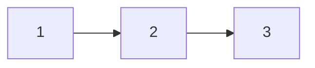

# Связные списки

Связный список хранит узлы со ссылками на следующий узел. Вставить после известного узла можно без сдвига остальных. Но чтобы найти позицию i, нужно пройти предыдущие связи: произвольного доступа по индексу за `O(1)` нет.

## Как менять связи безопасно

При развороте нужны три значения: начало уже развёрнутой части, текущий узел и сохранённый следующий. Сначала запомните следующий, затем разверните связь текущего. Иначе потеряется ещё не обработанный хвост.

Вспомогательный начальный узел, dummy, делает удаление первого элемента таким же изменением ссылки, как удаление любого другого. Он не должен попасть в результат.

## Как найти цикл без таблицы

Медленный указатель делает один переход, быстрый два. Если цикла нет, быстрый дойдёт до конца. В цикле их относительное расстояние меняется на один и они встретятся. Сравнивайте сами узлы, а не значения: два разных узла могут оба хранить 7.

Разворот и обнаружение цикла занимают `O(n)` времени и `O(1)` дополнительной памяти. Проверьте пустой список, единственный узел, изменение головы и цикл. Общие узлы нескольких списков делают изменение на месте видимым всем владельцам.

## Разворот 1 → 2 → 3

Для 1 → 2 → 3 сначала сохраняем `next=2`, направляем 1 на nil и переносим `prev` на 1. Далее сохраняем 3, направляем 2 на 1. Наконец сохраняем nil, направляем 3 на 2. Получается 3 → 2 → 1. На каждом шаге `prev` — уже развёрнутая часть, `cur` — начало оставшейся. Перезапись `cur.Next` до сохранения `next` потеряла бы хвост.

В цикле slow идёт на один узел, fast на два. Относительное расстояние меняется на один по кругу, поэтому встреча неизбежна. Для поиска входа после встречи поставьте один указатель на голову, затем двигайте оба по одному до совпадения. Сравнивайте адреса узлов: одинаковые значения не доказывают цикл.

## Проверь себя

1. **Почему вставка на позиции i не всегда O(1)?**

   

   
Ответ

   До нужного узла нужно дойти за O(i). Постоянную цену имеет изменение уже известных связей.

   

2. **Что сохранить перед cur.Next=prev?**

   

   
Ответ

   Прежний следующий узел, иначе потеряется ещё не обработанный хвост.

   

