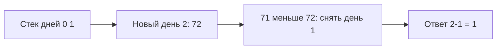

# Stack

Стек отдаёт последним добавленный элемент первым. Для скобок это последняя незакрытая скобка; монотонный стек хранит кандидатов, которым ещё не найден ответ.

## Что решает

Вложенные структуры, undo/path, iterative DFS, expression evaluation и nearest greater/smaller через monotonic stack.

## Как распознать

Последний открытый/добавленный элемент должен обрабатываться первым; нужно вернуться к parent; ответ для элемента зависит от ближайшего будущего, который вытесняет stack top.

## Шаблон

```text
for x in input:
    while stack not empty and should_pop(stack.top, x):
        resolve(pop, x)
    push x
```

Monotonic invariant: значения/indices в stack возрастают или убывают. Храните indices, если нужна distance.

## Сложность

Обычные push/pop `O(1)`. Monotonic pass `O(n)`: каждый элемент push/pop максимум раз; space `O(n)`.

## Типичные ошибки

Читать top пустого stack; хранить value вместо index; неверно обработать equality/duplicates; забыть unresolved elements после прохода; recursion stack overflow.

## Несколько задач

- valid parentheses;
- next greater element;
- daily temperatures;
- largest rectangle in histogram;
- normalize path / decode expression.

## Следующий более тёплый день

Температуры [73,71,72,74]. Храним индексы нерешённых дней с убывающей температурой. День0 → [0]; день1 → [0,1]; день2 снимает1, ответ для1 равен1; стек[0,2]. День3 снимает2 (ответ1), затем0 (ответ3). Результат[3,1,1,0]. Ноль последнего дня означает, что более тёплый не найден.



Равную температуру нельзя снимать, если нужен **строго** более тёплый день. Хранят индексы, а не только temperatures: нужен срок ожидания. Каждый индекс добавляется и удаляется максимум раз, значит вложенный while даёт O(n). После прохода нерешённые элементы остаются с нулевым ответом.

## Проверь себя

1. **Почему хранить indices вместо values?**

   <details>
   <summary>Ответ</summary>

   Нужна дистанция до следующего подходящего элемента.

   </details>

2. **Что меняется для больше или равно?**

   <details>
   <summary>Ответ</summary>

   Условие pop: equality теперь тоже закрывает старого кандидата.

   </details>
