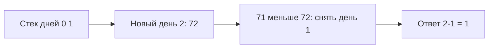

# Стек

Стек выдаёт последний добавленный элемент первым. Он хранит незавершённые действия: открытые скобки, путь обхода или элементы, которые ждут будущего ответа.

## Как проверять скобки

Открывающую скобку кладут в стек. Закрывающая должна совпасть с последней открытой; иначе последовательность неверна. После прохода стек должен быть пуст. Это проверяет вложенность, которую одних счётчиков типов недостаточно защитить.

## Что такое монотонный стек

Он дополнительно хранит элементы в возрастающем или убывающем порядке. Для следующего более тёплого дня держите индексы ещё не решённых дней. Новый день закрывает все дни наверху с меньшей температурой. Для каждого записывается расстояние до нового индекса.

Каждый элемент входит и выходит не более одного раза: `O(n)` времени и до `O(n)` памяти. Вложенный цикл удаления не делает решение квадратичным, потому что удалённый индекс больше не возвращается.

Равенство требует точного условия. Для **строго** более тёплого дня равную температуру не удаляют. Храните индексы, если нужен срок ожидания: одних значений недостаточно.

## Следующий более тёплый день

Температуры [73,71,72,74]. Храним индексы нерешённых дней с убывающей температурой. День0 → [0]; день1 → [0,1]; день2 снимает1, ответ для1 равен1; стек[0,2]. День3 снимает2 (ответ1), затем0 (ответ3). Результат[3,1,1,0]. Ноль последнего дня означает, что более тёплый не найден.

Равную температуру нельзя снимать, если нужен **строго** более тёплый день. Хранят индексы, а не только temperatures: нужен срок ожидания. Каждый индекс добавляется и удаляется максимум раз, значит вложенный while даёт O(n). После прохода нерешённые элементы остаются с нулевым ответом.

## Проверь себя

1. **Почему для следующего тёплого дня хранят индексы?**

   

   
Ответ

   Ответ — расстояние между днями. Одних температур недостаточно.

   

2. **Что изменится для следующего большего или равного элемента?**

   

   
Ответ

   Равное значение тоже завершает ожидание старого кандидата, поэтому меняется условие удаления.

   

