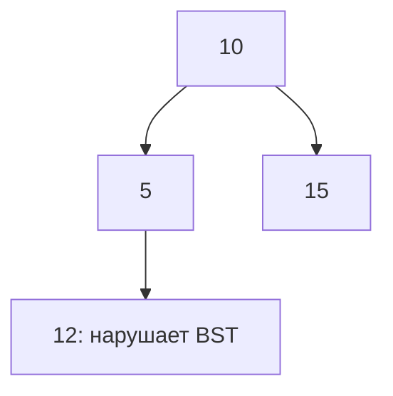

# Trees

Дерево — иерархия без циклов. Многие задачи решаются одинаково: получить ответы детей и из них вычислить ответ родителя.

## Что решает

Hierarchical data, subtree aggregates, path queries, ordered lookup (BST) и divide-and-conquer recursion.

## Как распознать

У каждого node children/parent relation; answer node выводится из child answers; traversal order (pre/in/post) соответствует моменту обработки.

## Шаблон

```text
dfs(node):
    if node == nil: return base
    left = dfs(node.left)
    right = dfs(node.right)
    return combine(node, left, right)
```

Формулируйте contract функции: что именно она возвращает parent и как обновляет global answer.

## Сложность

Полный traversal `O(n)` time, `O(h)` call stack; balanced tree `h=O(log n)`, skewed `h=O(n)`. BST lookup зависит от balance.

## Типичные ошибки

Считать дерево balanced; неверный base для height/leaf; global mutable result не reset; overflow recursion на chain; проверять BST только parent-child вместо allowed range.

## Несколько задач

- max depth/balance;
- validate BST;
- lowest common ancestor;
- diameter;
- serialize/deserialize tree.

## BST проверяется всем диапазоном



12 больше родителя5, но находится слева от10, значит дерево не BST. При обходе передавайте допустимый диапазон: левому child upper=parent, правому lower=parent. Для строгого BST равенства отклоняются; другой контракт duplicates должен задавать сторону. Не вычисляйте bound как value±1: крайний integer может переполниться. Используйте флаги наличия границ или optional values.

Для height(nil)=0 и height(node)=1+max(height children) дерево из одного узла имеет высоту1 в узлах. Диаметр в рёбрах через node равен leftHeight+rightHeight при такой конвенции; смешение единиц создаёт off-by-one. Проверка balance за O(n) возвращает height и признак failure вместе; повторное вычисление высоты каждого subtree на цепочке превращается в O(n²). Рабочий stack O(h), а не всегда O(log n).

## Проверь себя

1. **Почему сравнение только parent-child не проверяет BST?**

   <details>
   <summary>Ответ</summary>

   Узел должен удовлетворять ограничениям всех предков.

   </details>

2. **Как получить balance за O(n)?**

   <details>
   <summary>Ответ</summary>

   Postorder один раз вычисляет heights и признаки для каждого node.

   </details>
