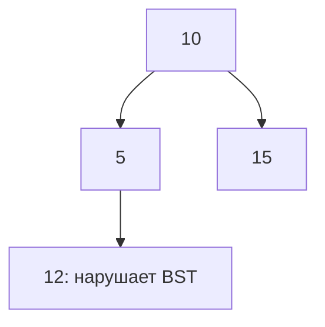

# Деревья

Дерево — связная структура без циклов. У корневого дерева есть корень и потомки. Двоичное дерево ограничивает число детей двумя; двоичное дерево поиска дополнительно задаёт порядок значений. Это разные свойства.

## Что возвращает рекурсия

Для высоты сначала получите высоты детей, затем верните `1+max(left,right)`. Это обработка после детей, postorder. Если высота пустого дерева равна 0, один узел имеет высоту 1 в узлах. Диаметр удобно измерять в рёбрах; не смешивайте единицы.

При обходе каждый узел посещается один раз: `O(n)`. Стек имеет глубину h, где h — высота. Только у сбалансированного дерева она порядка `log n`; цепочка имеет h=n. Повторный расчёт высоты каждого поддерева может дать `O(n²)`.

## Как проверить порядок поиска

Недостаточно сравнить узел только с родителем. Потомок слева от корня тоже должен быть меньше корня, даже если больше своего непосредственного родителя. Передавайте допустимые нижнюю и верхнюю границы от всех предков. Пример ниже показывает нарушение.

Дубликаты допустимы только по заданному контракту: запретить, хранить счётчик или определить сторону. Не задавайте границы через `value+1` и `value-1`: крайние целые переполнятся.

## BST проверяется всем диапазоном

Узел 12 больше своего родителя 5, но лежит слева от корня 10. Значит, дерево не является деревом поиска. Левому ребёнку передавайте верхнюю границу родителя, правому — нижнюю, сохраняя ограничения предков. Для строгого порядка равенства запрещены. Границы задавайте значением и признаком наличия, не `value±1`, которое может переполниться.

При `height(nil)=0` один узел имеет высоту 1 в узлах. Длина пути через узел в рёбрах равна сумме высот двух детей. Для проверки сбалансированности один обход возвращает высоту и признак нарушения вместе. Повторный расчёт высот всех поддеревьев на цепочке даст `O(n²)`. Память стека — `O(h)`, а не всегда `O(log n)`.

## Проверь себя

1. **Почему сравнение только с родителем не проверяет дерево поиска?**

   

   
Ответ

   Узел должен удовлетворять ограничениям всех предков, не одного.

   

2. **Как проверить сбалансированность за O(n)?**

   

   
Ответ

   Один обход после детей возвращает высоту и признак нарушения, не пересчитывая поддеревья.

   

