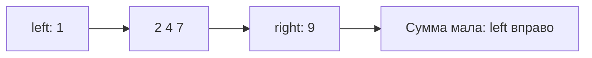

# Два указателя

Метод двух указателей хранит две позиции и двигает их так, чтобы не рассматривать заведомо бесполезные варианты. Он работает благодаря свойству данных, например сортировке, а не просто потому, что переменных две.

## Пара заданной суммы

В отсортированном массиве возьмите крайние числа. Если сумма меньше цели, левое число не даст нужную сумму ни с одним ещё меньшим правым, поэтому можно сдвинуть левый индекс. Если больше — симметрично сдвиньте правый. При равенстве найдена пара.

Каждый индекс движется не больше n раз: `O(n)` времени и `O(1)` памяти. Для двух разных элементов цикл идёт при `left<right`, не при равенстве индексов.

## Какие предположения проверить

На неотсортированных данных доказательство не работает. Сортировка добавит `O(n log n)` и изменит порядок; если нужны исходные индексы, храните пары «значение, индекс» или используйте [хеш-таблицу](hash-tables.md).

Другая разновидность — медленный и быстрый индекс при фильтрации: быстрый читает, медленный отмечает конец результата. Для связного списка быстрый и медленный указатели помогают найти цикл. У каждого варианта собственное доказательство, не общий рецепт движения.

## Трасса пары с суммой 10

Вход [1,2,4,7,9]. Пара крайних 1+9=10 найдена. Для target=11: 1+9=10 мало, left вправо; 2+9=11 найдено. Почему можно отбросить 1? С любым числом левее текущего right сумма с 1 ещё меньше, значит подходящей пары там нет.

На `[9,1,7,2,4]` числа не упорядочены и доказательство движения границ не действует. Сортировка поможет, но исходные индексы нужно сохранить отдельно. Альтернатива — хеш-таблица дополнений. Для пары разных элементов обязательно `left<right`. Сумма тоже может переполнить тип; выберите диапазон по условию.

## Проверь себя

1. **Почему при малой сумме двигают левый индекс?**

   

   
Ответ

   С текущим левым числом любой меньший правый даст ещё меньшую сумму. Эти пары бесполезны.

   

2. **Как сохранить исходные индексы после сортировки?**

   

   
Ответ

   Сортировать пары значение-индекс или выбрать хеш-таблицу предыдущих значений.

   

