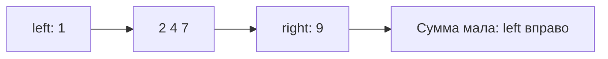

# Two pointers

Два указателя исключают невозможные варианты без перебора каждой пары. Движение безопасно только при доказанном свойстве, обычно отсортированности.

## Что решает

Pairs в отсортированные данные, на месте compaction, partition и сравнение последовательностей без nested full scan.

## Как распознать

Данные sorted или можно sort; при изменении суммы/условия понятно, какой pointer двигать; каждый pointer движется только вперёд/к центру.

## Шаблон

```text
left = 0; right = n-1
while left < right:
    v = f(a[left], a[right])
    if v == target: handle
    else if v < target: left++
    else: right--
```

Доказательство опирается на порядок сортировки: движение отбрасывает целый набор невозможных пар.

## Сложность

После сортировки scan `O(n)` time, `O(1)` space. Если sort не дан, общая стоимость обычно `O(n log n)` и возможна потеря исходных indices.

## Типичные ошибки

Применять к unотсортированные данные без доказательства; `left <= right` при выборе двух разных элементов; пропуск duplicate handling; overflow суммы; не обновить pointer во всех branches.

## Несколько задач

- pair sum в sorted array;
- remove duplicates на месте;
- container with most water;
- merge двух sorted arrays;
- palindrome после normalization.

## Трасса пары с суммой 10

Вход [1,2,4,7,9]. Пара крайних 1+9=10 найдена. Для target=11: 1+9=10 мало, left вправо; 2+9=11 найдено. Почему можно отбросить 1? С любым числом левее текущего right сумма с 1 ещё меньше, значит подходящей пары там нет.



Для [9,1,7,2,4] это доказательство не работает. Сортировка поможет, но потеряет исходные индексы; храните пары value/index либо используйте hash map для Two Sum. При выборе двух разных элементов условие left<right обязательно. Сумма двух int может переполниться; фиксируйте диапазон входа и выбирайте int64, если он достаточен.

## Проверь себя

1. **Почему при малой сумме двигаем left?**

   <details>
   <summary>Ответ</summary>

   Ни один меньший right не даст с текущим left достаточной суммы.

   </details>

2. **Как сохранить исходные индексы после сортировки?**

   <details>
   <summary>Ответ</summary>

   Сортировать пары value/index или использовать complement lookup map.

   </details>
