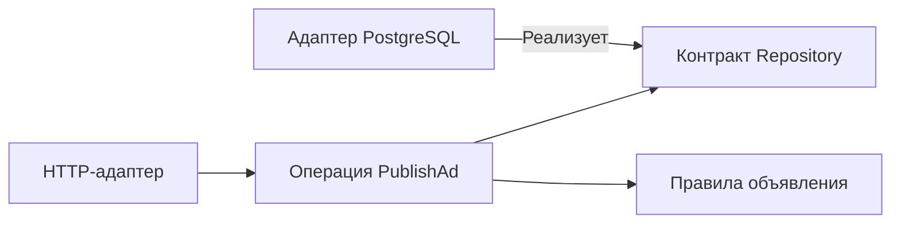

# Чистая архитектура: куда направлять зависимости

Правила продукта должны быть понятны без знания HTTP-фреймворка и драйвера БД. Чистая архитектура организует код так, чтобы эти правила не зависели от технических способов ввода и хранения.

## Как это работает

Например, правило «можно публиковать только проверенное объявление» принадлежит приложению. HTTP-обработчик разбирает запрос, а реализация хранилища выполняет SQL. При смене маршрута или драйвера правило не меняется.

Приложение определяет небольшой интерфейс необходимого действия, например PublishIfApproved. Внешний SQL-код реализует его. Во время выполнения приложение вызывает БД через интерфейс, но в исходниках именно SQL-пакет зависит от контракта приложения. Это и есть правило направления зависимостей.

Дополнительные слои стоят времени: появляются преобразования типов и сборка объектов. Если каждый слой лишь копирует сорок полей и передаёт вызов дальше, польза сомнительна. Разделяйте то, что меняется по разным причинам, а свойства настоящей БД проверяйте интеграционными тестами.

## Разобранный пример

Операция PublishAd знает объявление, результат модерации и контракт PublishIfApproved. HTTP-код разбирает JSON, операция определяет допустимый переход, SQL-реализация атомарно сохраняет его. Изменение маршрута не меняет правило публикации.

Стрелки схемы показывают зависимости исходников. Во время выполнения операция вызывает SQL-реализацию через свой интерфейс. Save(any) слишком мало сообщает о требуемом свойстве; PublishIfApproved(expectedVersion) выражает проверку состояния и версии. Тестовая реализация удобна для правил, но реальные ограничения, блокировки и изоляцию БД проверяют отдельно.

## Проверь себя

1. Почему направления вызова и зависимости отличаются?
2. Что не доказывает тестовая реализация репозитория?

Ответы

1. Операция вызывает реализацию через интерфейс, который определён внутри приложения.
2. Поведение настоящих SQL-блокировок, ограничений, изоляции и планов запросов.

## Источники

- [Clean Coder Blog: The Clean Architecture](https://blog.cleancoder.com/uncle-bob/2012/08/13/the-clean-architecture.html)
