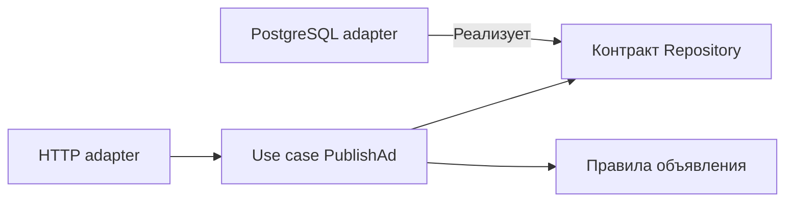

# Clean Architecture

Правило зависимостей: бизнес-правила не должны импортировать детали HTTP, драйвер БД и поставщика платежей.

Clean Architecture организует policy концентрическими границами: enterprise/domain rules внутри, application use cases вокруг, interface adapters и frameworks снаружи. Dependency Rule: source-code dependencies направлены внутрь, к более устойчивой policy.

## Что это означает

- domain types не импортируют web framework или SQL driver;
- use case определяет необходимый outbound contract (договорённость о поведении и гарантиях);
- controller/presenter переводит внешний protocol;
- composition root (место сборки зависимостей приложения) создаёт concrete adapters и связывает graph.

Направление runtime call может идти наружу через interface; направление compile-time dependency остаётся внутрь. Это тот же основной механизм, что в hexagonal architecture, с другой терминологией и акцентом.

## Не путать с числом папок

Четыре каталога не делают систему clean. Boundary оправдан, если стороны имеют разные причины изменения и contract можно сформулировать. Если entity — копия database row, use case только вызывает repository, а mapper механически дублирует 40 полей, структура не снижает coupling.

## Компромиссы

Изоляция policy облегчает unit tests и замену infrastructure, но увеличивает mapping/wiring и может скрыть performance-critical возможности storage. Иногда application query сознательно использует read model/SQL projection (производная модель для чтения) в обход богатого domain model — это допустимая оптимизация с явной границей.

Используйте Dependency Rule для сложных или долгоживущих business rules. Не превращайте архитектурную схему в запрет использовать возможности platform там, где они составляют сам продукт.

## Источник

- [Clean Coder Blog: The Clean Architecture](https://blog.cleancoder.com/uncle-bob/2012/08/13/the-clean-architecture.html)

## Механизм на примере

Пусть use case `PublishAd` знает `Ad`, `ModerationResult` и `Repository.PublishIfApproved`. HTTP-обработчик декодирует JSON, PostgreSQL adapter (адаптер конкретной технологии к контракту) реализует атомарное условие, use case определяет допустимый переход. Изменение маршрута API не меняет правила публикации.

Стрелки показывают зависимости исходного кода. Реальный вызов идёт из use case через интерфейс в adapter. Интерфейс `Save(any)` не выражает нужного свойства; `PublishIfApproved(expectedVersion)` выражает. Если production использует isolation/unique constraints, fake repository обязан быть дополнен integration test: fake не доказывает поведение настоящей БД.

## Проверь себя

1. Почему исходная зависимость не совпадает с направлением runtime call?
2. Что не доказывает fake repository?

Ориентиры для ответа

1. Интерфейс определён внутри, внешний adapter реализует его и вызывается полиморфно.
2. SQL isolation, locks, constraints и планы запросов.

