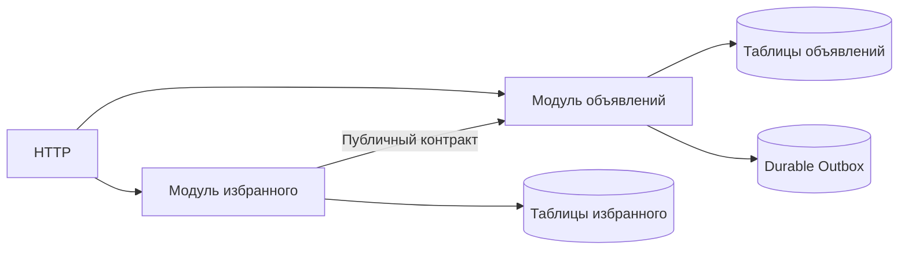

# Modular monolith

Модульный монолит — один процесс с отдельными владельцами возможностей и данных.

Modular monolith — один deployable/process с явными bounded (с явным конечным пределом) modules. Он сохраняет простоту локальных calls и transactions, но ограничивает compile-time/data coupling.

## Правила модуля

- public API/capabilities отделены от internal packages;
- module владеет своей schema/tables и migrations;
- другой module не читает его таблицы напрямую;
- synchronous calls идут через public interface, asynchronous — через typed events;
- dependency graph направлен и проверяется tooling/tests;
- composition root (место сборки зависимостей приложения) связывает modules, не business packages.

Physical database может быть общей, но ownership (владение данными или ответственность за ресурс) логический. Cross-module transaction допустима как осознанный monolith benefit, однако она усложняет будущую extraction; отмечайте такие invariants явно.

## Events внутри процесса

In-process event не durable: process crash теряет queued work. Если результат обязан пережить commit/restart, используйте transactional outbox (события, сохранённые вместе с бизнес-изменением) даже внутри monolith. Не притворяйтесь, что локальный event bus уже обеспечивает Kafka semantics.

## Компромиссы

Плюсы: один deployment, простая локальная диагностика, низкая latency (срок ответа), refactoring через compiler. Риски: границы легко обходить, релизы связаны, один crash/resource leak влияет на process, масштабирование крупнозернистое.

Extraction успешна, когда module уже имеет contract (договорённость о поведении и гарантиях), data ownership и telemetry (диагностические данные: метрики, логи и traces). Сначала перенесите read/write ownership и сделайте network failure явным, затем отделяйте deployment; dual write без протокола reconciliation (сверка и устранение расхождений) опасен.

Для малого продукта обычный хорошо структурированный monolith достаточен. Modular constraints окупаются при нескольких capabilities/teams или вероятной независимой эволюции.

## Механизм на примере

Модули ads и favorites используют одну PostgreSQL, но favorites получает доступ к карточке через API модуля ads. Физическая близость таблиц не разрешает произвольные UPDATE чужих данных. В Go `internal` ограничивает import относительно родительского дерева; структура каталога должна соответствовать требуемой границе, одного имени папки недостаточно.

Перед выделением favorites в сервис перечисляем общие транзакции. Если одна транзакция запрещает добавлять удалённый ad, после разделения проверка и вставка могут разделиться отказом сети. Нужно изменить контракт: допустить устаревшую связь с фильтрацией на чтении либо обеспечить reservation/согласованную власть. Перенос HTTP между прежними пакетами сам этого не решает.

## Источник механизма

[Go: организация module и internal packages](https://go.dev/doc/modules/layout). Числа и topology в примерах — учебные допущения, не параметры этой системы.

## Проверь себя

1. Почему in-process очередь не durable?
2. Что проверить перед выделением модуля?

Ориентиры для ответа

1. После падения процесса несохранённая работа исчезает.
2. Общие транзакции, data ownership, неизвестные исходы и восстановление.

