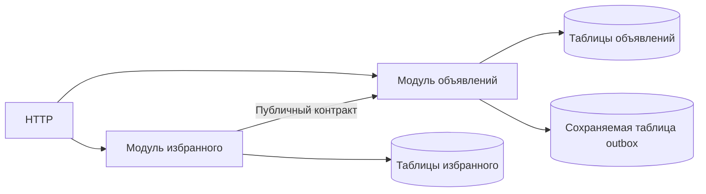

# Модульный монолит

Модульный монолит — одно развёртываемое приложение с внутренними границами между частями продукта. Разделить код можно раньше, чем разделить процессы и базы.

## Как это работает

Например, модуль объявлений владеет правилами публикации, а модуль платежей — списанием средств. Другие модули обращаются к их публичным операциям, вместо прямого изменения чужих таблиц. Ограничение импортов и понятный владелец данных защищают границы.

Общий процесс упрощает вызовы, диагностику и локальные транзакции. Однако общий пул или бесконечный цикл одного модуля способен повредить всему приложению: границы кода не дают изоляции ресурсов.

Если одна часть позже требует независимого масштабирования, её легче выделить при существующем контракте. Но после выделения локальный вызов превратится в сетевой: появятся таймауты, неизвестные исходы и необходимость согласовывать данные. Не стоит заранее имитировать сеть внутри монолита без причины.

## Разобранный пример

Модули объявлений и избранного используют одну PostgreSQL, но избранное получает карточку через контракт модуля объявлений. Близость таблиц не разрешает изменять чужие данные произвольным UPDATE. В Go каталог internal ограничивает импорт относительно родительского дерева, а не магически запрещает все нежелательные зависимости.

Перед выделением избранного в отдельный сервис найдите общие транзакции. Раньше проверка «объявление не удалено» и вставка могли быть атомарными. После разделения между ними возможны сеть и отказ. Нужен новый договор: например, допустить устаревшую связь и фильтровать её при чтении либо обеспечить общий механизм согласования.

## Проверь себя

1. Даёт ли граница модуля изоляцию CPU и памяти?
2. Что проверить перед выделением сервиса?

Ответы

1. Нет, всё ещё используется общий процесс.
2. Владение данными, общие транзакции и гарантии, которые изменятся после появления сети.

## Источники

- [Go: организация module и internal packages](https://go.dev/doc/modules/layout)
