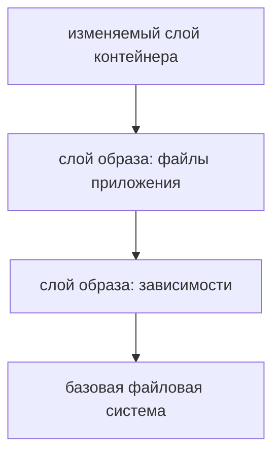

# Образы и слои

Образ содержит неизменяемые слои файлов и настройки запуска. Контейнер добавляет сверху свой слой изменений. **Тег** — имя, которое можно переназначить; **digest** идентифицирует конкретное содержимое.

Многоплатформенный тег может вести на индекс, который выбирает отдельный образ для архитектуры. Локальный ID образа и digest репозитория не всегда обозначают одно и то же.

## Почему удаление не стирает слой

```dockerfile
COPY secret.txt /secret.txt
RUN rm /secret.txt
```

Итоговая файловая система скрывает секрет, но нижний слой по-прежнему содержит его байты. Удаление сверху не очищает опубликованную историю. Секрет нужно вообще не копировать в образ: используйте временное подключение BuildKit и не записывайте его командой в результат.



## Кеш сборки

BuildKit связывает шаги с их входными данными. Изменение инструкции или входного файла пересобирает этот шаг и зависящие от него. Сначала копируют `go.mod`/`go.sum` и скачивают зависимости, затем исходники: изменение кода не заставляет повторять неизменную подготовку зависимостей.

`.dockerignore` исключает `.git`, локальные бинарные файлы и секреты. `RUN --mount=type=cache` может сохранять кеш модулей и сборки; временный CI может использовать удалённый кеш с подходящей политикой доступа.

`--no-cache` выполняет инструкции заново, но не обязательно получает новый базовый образ. Для этого нужен `--pull`. Зафиксированный digest улучшает воспроизводимость, но его нужно регулярно обновлять ради исправлений. Состав компонентов и происхождение сборки фиксируют отдельно.

## Размер и рабочее окружение

Несколько этапов сборки позволяют скопировать в финальный этап только результат без компилятора и исходников. Малый размер ускоряет передачу и уменьшает доступные инструменты атаки, но приложение всё ещё может нуждаться в сертификатах CA, часовых поясах, libc или библиотеках cgo.

`docker image inspect image --format '{{.Id}} {{json .RepoDigests}}'` помогает посмотреть локальный ID и digest. Само наличие небольшого образа не доказывает, что он пригоден для диагностики и запуска.

## Источники

- [Build cache](https://docs.docker.com/build/cache/)
- [Multi-stage builds](https://docs.docker.com/build/building/multi-stage/)

## Проверь себя

1. Почему тег не гарантирует прежнее содержимое?
2. Что даёт сборка в несколько этапов?

<details>
<summary>Ответы</summary>

1. Тег можно переназначить.
2. В рабочий образ попадает нужный результат без временных файлов и инструментов сборки.

</details>
