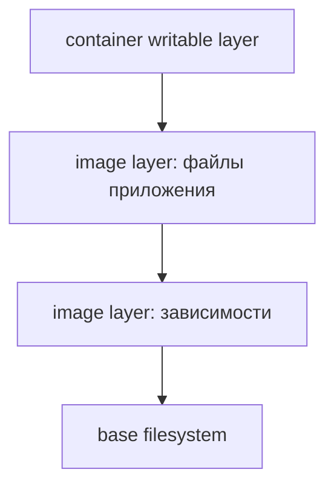

# Images и layers

Образ состоит из неизменяемых слоёв файлов и настроек. Container добавляет свой слой изменений; tag — изменяемое имя, digest (криптографический идентификатор конкретного содержимого) — адрес конкретного содержимого.

Image состоит из immutable (неизменяемый после создания) filesystem layers и configuration; digest идентифицирует content manifest, tag — mutable name. Multi-platform tag может указывать на image index с разными manifests для architectures.

Container добавляет writable layer поверх image через storage driver. Удаление/изменение файла создаёт upper-layer metadata/data и не уменьшает lower layer: секрет, добавленный ранним `COPY`, остаётся в history даже после `RUN rm`.

## Build cache

BuildKit строит content-addressed dependency graph. Изменение instruction/input invalidates этот step и dependants. Для быстрого и корректного cache:

- маленький `.dockerignore`, без `.git`, binaries, secrets;
- сначала `COPY go.mod go.sum` + download, затем source;
- `RUN --mount=type=cache` для module/build cache;
- remote cache в ephemeral CI;
- reproducible dependency lock и pinned base policy.

`--no-cache` переисполняет instructions, но не обязательно pull-ит свежий base; для этого нужен `--pull`. Mutable tags ухудшают reproducibility; production provenance (проверяемые данные о происхождении сборки) фиксирует digest/SBOM/signature и сознательно обновляет его.

Image size влияет на transfer/start/cache и attack surface, но smallest не всегда operable: CA certificates, timezone, libc/CGO и debug needs должны быть явными. Multi-stage build удаляет compiler/source из final image.

## Удалённый секрет остаётся в истории

```dockerfile
COPY secret.txt /secret.txt
RUN rm /secret.txt
```

Итоговый filesystem не показывает файл, но ранний layer содержит его bytes. Удаление сверху скрывает данные, а не очищает опубликованный слой. Исправление — не копировать secret в image, использовать build secret mount и не записывать его command в result.



`docker image inspect image --format '{{.Id}} {{json .RepoDigests}}'` показывает local identity и repository digests; они не всегда одно и то же. Multi-platform index указывает на отдельные manifests. `--no-cache` не обещает новый base: обновление base требует pull и контролируемого изменения digest.

## Источники

- [Build cache](https://docs.docker.com/build/cache/)
- [Multi-stage builds](https://docs.docker.com/build/building/multi-stage/)

## Проверь себя

1. Почему tag не гарантирует прежний image?
2. Что даёт multi-stage build?

<details>
<summary>Ориентиры для ответа</summary>

1. Tag можно переназначить на другое содержимое.
2. В final stage копируется нужный artifact, без compiler и временных файлов build stage.

</details>
