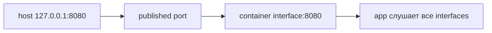

# Docker networking

Container обычно имеет собственную сеть. Published port связывает порт host с портом container, а Docker DNS помогает containers общей сети найти друг друга.

Linux container обычно имеет network namespace с interfaces/routes. User-defined bridge подключает containers виртуальной сетью и предоставляет name resolution; опубликованный port на host направляет traffic к container port.

```bash
docker network create app-net
docker run --network app-net --name api api-image
docker run -p 127.0.0.1:8080:8080 api-image
```

`EXPOSE 8080` не публикует port. `-p 8080:8080` без host IP часто слушает все host interfaces — проверьте firewall/exposure. Container должен слушать `0.0.0.0`/`::`, не только loopback собственного namespace.

На user-defined network обращайтесь к service name и container port, а не published host port. IP container ephemeral. DNS caching client/runtime может удерживать старый address; connection pool должен обновляться через reconnect/discovery.

Default bridge, user-defined bridge, host, none и overlay имеют разные isolation/routing. Host mode убирает отдельный network namespace path/port mapping и повышает collision/exposure; нужен редко.

## Diagnostics

```bash
docker network inspect app-net
docker port <container>
docker exec <container> cat /etc/resolv.conf
nsenter -t <host-pid> -n ss -lntp
```

Различайте application listen, container route/DNS, host publish/firewall и upstream load balancer. Не устанавливайте debug tools в production image только ради incident: используйте dedicated debug container/namespace access.

## Две независимые настройки доступности

```bash
docker run --rm -p 127.0.0.1:8080:8080 api-image
```

Host слушает только loopback, но приложение **внутри** container должно слушать `:8080`/`0.0.0.0:8080`. Если оно слушает `127.0.0.1:8080` внутри своего namespace, перенаправленный traffic не попадёт на этот endpoint. В Docker Desktop host/container networking дополнительно проходит через VM, поэтому не переносите Linux-specific детали на него без проверки.



Не используйте IP container как постоянную конфигурацию: после replacement он меняется. В user-defined bridge вызов `http://api:8080` использует имя и внутренний port, без host publish.

## Источники

- [Docker networking overview](https://docs.docker.com/engine/network/)

## Проверь себя

1. Публикует ли EXPOSE порт?
2. Почему host mapping не исправляет listen на container localhost?

<details>
<summary>Ориентиры для ответа</summary>

1. Нет, это metadata; доступ задают run/network settings.
2. Это другая loopback-сеть; app должна принимать на container interface.

</details>
