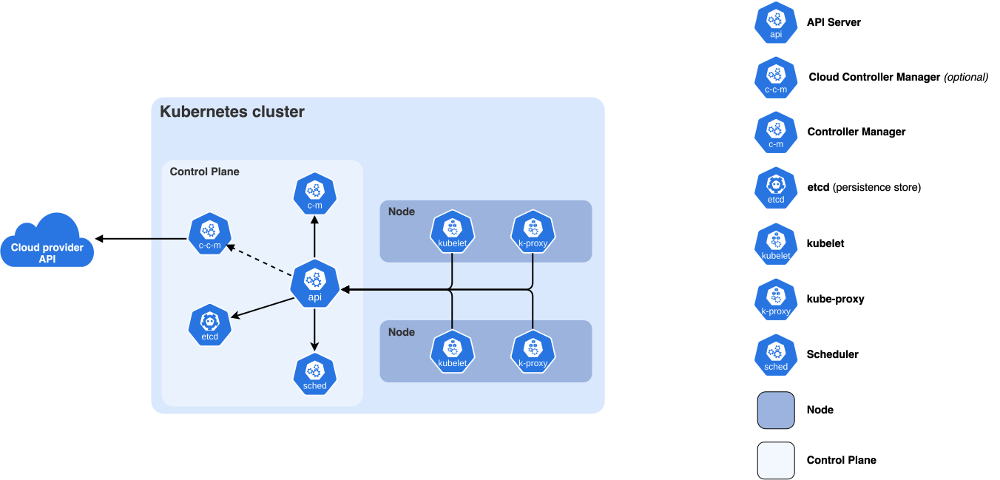

# Kubernetes

Kubernetes поддерживает желаемое состояние: например, три экземпляра API, доступные через общее имя. Компоненты замечают расхождение с фактическим состоянием и пытаются его устранить. Но само приложение должно правильно проверять готовность, ограничивать работу и останавливаться.

Материал опирается на Kubernetes 1.37; официальная страница релизов на 6 октября 2026 указывает 1.37.1. Реализацию сети, хранилища, контроллеров и экспериментальные настройки проверяйте в конкретном кластере.

Источник: [Kubernetes contributors](https://kubernetes.io/docs/concepts/overview/components/), лицензия [CC BY 4.0](https://creativecommons.org/licenses/by/4.0/).

## Что делают компоненты

| Компонент | Ответственность |
|---|---|
| API server | Принимает запросы, проверяет доступ и записывает желаемое состояние |
| etcd | Хранит состояние управления; нуждается в резервных копиях и защите |
| Планировщик | Выбирает узел для ещё не размещённого Pod |
| Контроллеры | Замечают расхождения и меняют объекты для достижения цели |
| Kubelet | На узле приводит контейнеры к заданному описанию Pod |
| Среда контейнеров | Запускает и останавливает процессы через интерфейс CRI |
| Сетевой механизм | Создаёт сеть Pod и передачу к адресатам Service |

Компоненты управления сохраняют и согласуют состояние; рабочие узлы выполняют приложения. Успех запроса API не означает, что Pod уже запущен: следующие действия выполняют отдельные компоненты с задержкой.

## Темы

- [Автоматическое масштабирование](autoscaling.md)
- [ConfigMap и Secret](configmap-and-secret.md)
- [Deployment](deployment.md)
- [Корректная остановка](graceful-shutdown.md)
- [Ingress](ingress.md)
- [Сеть Kubernetes](networking.md)
- [Диагностика Kubernetes](troubleshooting.md)
- [Pod](pod.md)
- [Проверки состояния](probes.md)
- [Ресурсы](resources.md)
- [Service](service.md)

## Источники

- [Kubernetes 1.37 release](https://kubernetes.io/releases/1.37/)
- [Kubernetes concepts](https://kubernetes.io/docs/concepts/)
