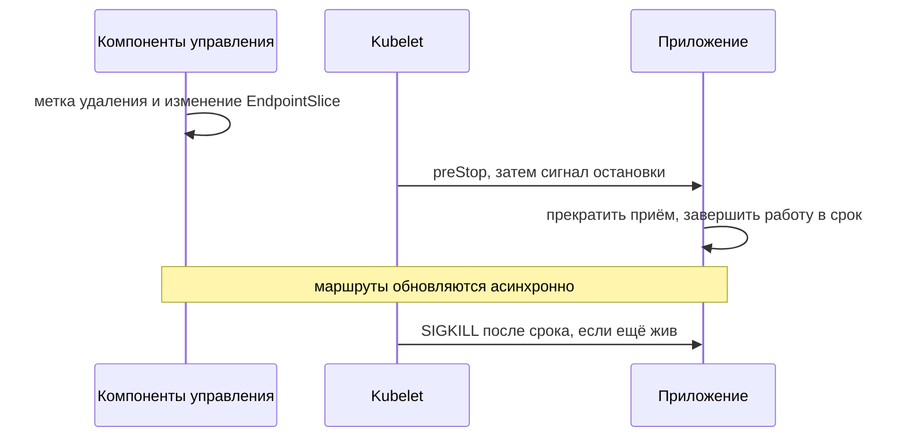

# Корректная остановка Pod

Удаление Pod не выключает все сетевые маршруты одновременно. API отмечает начало удаления, контроллеры обновляют адреса Service, а kubelet запускает остановку локально. Пока изменения распространяются, Pod ещё может получить запрос.

## Общий срок

Если задан `preStop`, kubelet выполняет его, затем посылает сигнал остановки, обычно `SIGTERM`. Всё укладывается в `terminationGracePeriodSeconds`, по умолчанию 30 секунд. После срока оставшиеся процессы получают `SIGKILL`.

```yaml
spec:
  terminationGracePeriodSeconds: 45
```

При сроке 45 секунд hook, ждущий 10 секунд, оставляет около 35 на реакцию TERM и завершение работы. Он не добавляет время сверху. Фиксированная пауза может помочь распространению маршрутов, но выбирать её нужно по измерению реального пути.

## Действия приложения

Приложение получает TERM через `signal.NotifyContext`, перестаёт принимать новую работу и снимает готовность. HTTP использует `Shutdown`; gRPC — `GracefulStop` с ограничением ожидания и переходом к `Stop`. Обработчик очереди прекращает получение, завершает или возвращает сообщения без раннего подтверждения результата. Критичные данные и телеметрия отправляются в отдельном коротком бюджете.

Уже отменённый контекст сигнала нельзя использовать для ожидания завершения: он сразу прервёт его. Долгий поток передачи также нельзя ждать бесконечно.



В современных EndpointSlices удаляемый адрес имеет отдельные условия: `ready=false`, а `serving` помогает поддерживающему сетевому механизму завершать активную работу. Конкретный балансировщик и CNI могут трактовать это по-разному: проверяйте фактический путь.

## Проверка отказа

Тест должен включать активный ограниченный запрос и долгий поток, посылать TERM и подтверждать остановку приёма и завершение в срок. У принудительно прерванной записи результат может быть неизвестен. Повтор допускается только с защитой от повторного эффекта. Клиентские сроки и повторные попытки не отменяют необходимость такого контракта.

## Источники

- [Pod termination](https://kubernetes.io/docs/concepts/workloads/pods/pod-lifecycle/#pod-termination)
- [Go graceful shutdown](../../go/backend/graceful-shutdown.md)

## Проверь себя

1. Добавляет ли `preStop` время к общему сроку остановки?
2. Останавливает ли `readiness=false` трафик мгновенно?

<details>
<summary>Ответы</summary>

1. Нет, расходует тот же срок.
2. Нет: обновления распространяются с задержкой, а соединения уже могут быть открыты.

</details>
