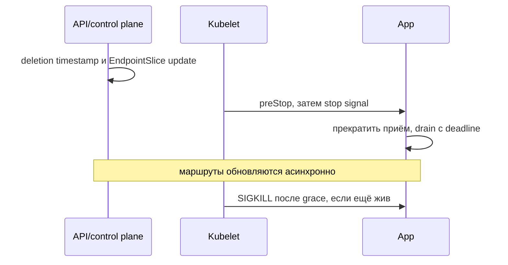

# Graceful shutdown

Удаление Pod и удаление сетевого маршрута происходят распределённо. Приложение ещё может получить запрос после начала termination, поэтому оно должно корректно завершать приём.

При удалении Pod API ставит deletion timestamp; control plane обновляет EndpointSlices, а kubelet начинает local termination. Эти действия происходят распределённо, поэтому некоторое время новый traffic ещё может прийти.

Kubelet выполняет `preStop` hook, если задан, затем посылает container stop signal (обычно `SIGTERM`). Весь процесс ограничен `terminationGracePeriodSeconds` (default 30 s); после grace period оставшиеся processes получают `SIGKILL`.

## Application sequence

1. Получить TERM через `signal.NotifyContext`.
2. Сделать application readiness (готовность к операции или к приёму новой работы в указанном контексте) false/остановить intake.
3. Закрыть listener или вызвать HTTP `Shutdown`; gRPC сначала `GracefulStop` с timeout fallback `Stop`.
4. Остановить polling consumer, завершить/вернуть in-flight records без раннего offset commit.
5. Flush critical telemetry/state в короткий bounded budget.
6. Exit 0 до platform deadline.

`preStop: sleep` может дать LB время, но съедает тот же grace budget и маскирует lifecycle race. Предпочитайте корректное endpoint termination handling и internal drain (завершение уже принятой работы); fixed delay добавляйте только после измерения инфраструктуры.

```yaml
spec:
  terminationGracePeriodSeconds: 45
```

Shutdown budget включает worst request/RPC, queue ack и safety margin, но не должен позволять бесконечный stream. Client deadlines/retries/idempotency закрывают принудительное завершение.

Integration test: active request + TERM, проверка отсутствия новой работы, завершения bounded calls и отсутствия `SIGKILL`/duplicate side effects.

## preStop расходует общий срок

При `terminationGracePeriodSeconds=45` hook, который ждёт 10 секунд, оставляет около 35 секунд на TERM и завершение. Он не добавляет новый бюджет сверху. Долгий бесконечный stream нельзя ждать без предела; gRPC GracefulStop должен иметь fallback Stop.



На современных EndpointSlices terminating endpoint имеет отдельные conditions: ready=false для совместимости, serving помогает поддерживающим data planes продолжить drain. Но конкретный LB/CNI может обрабатывать это по-своему: проверьте реальный путь трафика.

Тест с TERM должен покрывать один активный bounded request и один long-lived stream, а также неизвестный исход write. Retry команды допускается только при идемпотентном контракте.

## Источники

- [Pod termination](https://kubernetes.io/docs/concepts/workloads/pods/pod-lifecycle/#pod-termination)
- [Go graceful shutdown](../../go/backend/graceful-shutdown.md)

## Проверь себя

1. Добавляет ли preStop время к grace period?
2. Гарантирует ли readiness=false немедленное прекращение traffic?

<details>
<summary>Ориентиры для ответа</summary>

1. Нет, потребляет тот же общий срок.
2. Нет, распространение и существующие соединения асинхронны.

</details>
