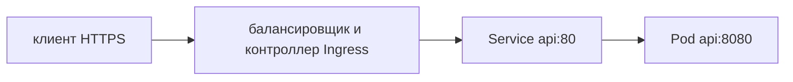

# Ingress

Ingress описывает, куда направить внешний HTTP-запрос по имени и пути. **Контроллер** — программа, которая реализует эти правила. Без подходящего контроллера объект Ingress сам ничего не публикует.

```yaml
apiVersion: networking.k8s.io/v1
kind: Ingress
metadata: {name: api}
spec:
  ingressClassName: public
  rules:
    - host: api.example.com
      http:
        paths:
          - path: /
            pathType: Prefix
            backend:
              service: {name: api, port: {number: 80}}
```

Пример выбирает класс `public` и направляет `api.example.com` к Service `api:80`. Контроллер определяет поддержку TLS, ограничений, повторов и специальных annotations.

## Путь запроса



TLS может завершаться на контроллере, а до Pod идти обычный HTTP. Для шифрования каждого участка нужны отдельные настройки. `X-Forwarded-For` доверяют только от известных прокси, иначе клиент может подделать источник.

## Настройки, которые нужно согласовать

Явно выбирайте `ingressClassName`. Определите жизненный цикл сертификата, перенаправление на HTTPS, пределы заголовков и тела, общий срок и сроки отдельных попыток. Повторы записи разрешены только с защитой от повторного эффекта. Размещение проверки прав, ограничения частоты и фильтрации должно быть понятным.

Поддержка gRPC, HTTP/2, WebSocket и переписывание путей зависят от контроллера. Правила с регулярными выражениями часто непереносимы.

```bash
kubectl describe ingress api
kubectl get ingressclass
kubectl logs -n <ns> <ingress-controller-pod>
```

Проверка через port-forward подтверждает лишь часть пути приложения: она обходит внешний TLS и маршрутизацию Ingress. Проверьте реальный Host, класс, порт, сертификат и логи контроллера.

Ingress API стабилен, но новые возможности в него не добавляются. Kubernetes рекомендует Gateway API для более развитой маршрутизации. Это не означает немедленного удаления Ingress: учитывайте установленную реализацию платформы.

## Источники

- [Ingress](https://kubernetes.io/docs/concepts/services-networking/ingress/)
- [Gateway API](https://gateway-api.sigs.k8s.io/)

## Проверь себя

1. Почему созданный Ingress может ничего не публиковать?
2. Что не проверяет port-forward?

<details>
<summary>Ответы</summary>

1. Может отсутствовать подходящий контроллер или класс.
2. Полный внешний путь через балансировщик, TLS и Ingress.

</details>
