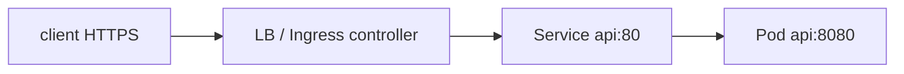

# Ingress

Ingress задаёт правила HTTP-входа, а controller реализует их. Создать объект без controller — всё равно что записать настройку без исполняющей программы.

Ingress resource описывает HTTP/HTTPS host/path routing к Services. Без установленного Ingress controller он ничего не делает. Controller implementation определяет annotations, TLS, retries, timeouts, limits и status.

```yaml
apiVersion: networking.k8s.io/v1
kind: Ingress
metadata: {name: api}
spec:
  ingressClassName: public
  rules:
    - host: api.example.com
      http:
        paths:
          - path: /
            pathType: Prefix
            backend:
              service: {name: api, port: {number: 80}}
```

Ingress API stable, но feature set frozen; Kubernetes рекомендует Gateway API для новых richer routing use cases. Это не означает мгновенную deprecated removal: выбор зависит от installed controllers и platform roadmap.

## Design

- `ingressClassName` явно выбирает controller;
- TLS Secret/issuer lifecycle и redirect policy;
- max body/header, request/per-try timeout;
- trusted proxy/source IP и forwarded headers;
- idempotent-only retries с budgets;
- rate/WAF/auth placement;
- gRPC/HTTP2/WebSocket support конкретного controller.

Path rewriting/regex annotations непереносимы. Test должен проходить через реальный controller/LB, не только Service.

```bash
kubectl describe ingress api
kubectl get ingressclass
kubectl logs -n <ns> <ingress-controller-pod>
```

## Различить Service и внешний путь



Если port-forward работает, это подтверждает часть app path, но обходит внешний TLS, Ingress routing и часть политики. Проверяйте host header `api.example.com`, ingressClass, backend port, certificate и controller logs.

TLS terminates на controller — тогда до Pod может идти HTTP; end-to-end encryption требует отдельной настройки. Заголовок X-Forwarded-For доверяют только от известных proxy, иначе клиент подделает адрес. Retry POST controller-ом способен повторить запись: правила retries согласуют с идемпотентностью API.

## Источники

- [Ingress](https://kubernetes.io/docs/concepts/services-networking/ingress/)
- [Gateway API](https://gateway-api.sigs.k8s.io/)

## Проверь себя

1. Почему Ingress object может ничего не публиковать?
2. Что не проверяет port-forward?

<details>
<summary>Ориентиры для ответа</summary>

1. Отсутствует подходящий controller или class.
2. Полный внешний LB/TLS/Ingress/network-policy путь.

</details>
