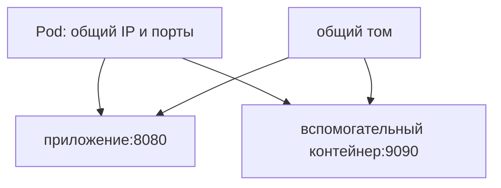

# Pod

Pod — минимальная единица запуска Kubernetes: один или несколько тесно связанных контейнеров на одном узле. У них общий IP и порты, а тома подключаются по объявленным правилам. Поэтому они могут общаться через `localhost`.

## Что общее, а что отдельно

Приложение на 8080 и вспомогательный прокси на 9090 используют общую сеть. Если оба пытаются слушать одинаковый IP:8080, обычно возникает конфликт. Пространство процессов не обязательно общее: `shareProcessNamespace` включается отдельно. Файловые системы и ограничения контейнеров также зависят от настроек.

Pod не является вечной идентичностью. При замене контроллер создаёт новый UID и IP. Важные данные храните во внешнем хранилище или PersistentVolume, а адрес обнаруживайте через Service. Даже стабильное имя StatefulSet не делает память процесса долговечной.

## Виды контейнеров

Обычные init-контейнеры последовательно завершаются до запуска приложения. Вспомогательные sidecar могут жить вместе с ним и добавляют ресурсные расходы и правила остановки. Нативный sidecar может быть перезапускаемым init-контейнером с другим жизненным циклом. Временные диагностические контейнеры предназначены для расследования, а не обычной работы.

```bash
kubectl get pod <pod> -o wide
kubectl describe pod <pod>
kubectl get pod <pod> -o yaml
```

## Состояния

Фазы `Pending`, `Running`, `Succeeded`, `Failed`, `Unknown` дают общую картину. Подробности находятся в состояниях контейнеров и событиях. `Running` не означает `Ready`: проверка готовности ещё может не пройти. `CrashLoopBackOff` показывает паузу перед очередным запуском после падений, а не объясняет их причину.



## Размещение и управление

Планировщик учитывает requests, правила разрешённых и предпочтительных узлов, распределение по зонам и запреты узла. Задавайте идентичность ServiceAccount и security context осознанно. Для долгоживущего сервиса нужен Deployment или StatefulSet: простой Pod сам не управляет заменой. Для конечной работы используется Job. Перезапуск контейнера kubelet и замена Pod контроллером — разные действия.

## Источники

- [Pods](https://kubernetes.io/docs/concepts/workloads/pods/)
- [Pod lifecycle](https://kubernetes.io/docs/concepts/workloads/pods/pod-lifecycle/)

## Проверь себя

1. Можно ли два контейнера Pod обычно привязать к одному IP:порту?
2. Чем `Running` отличается от `Ready`?

<details>
<summary>Ответы</summary>

1. Нет: пространство портов общее.
2. Фаза описывает общую жизнь Pod, готовность — возможность принимать новую работу.

</details>
