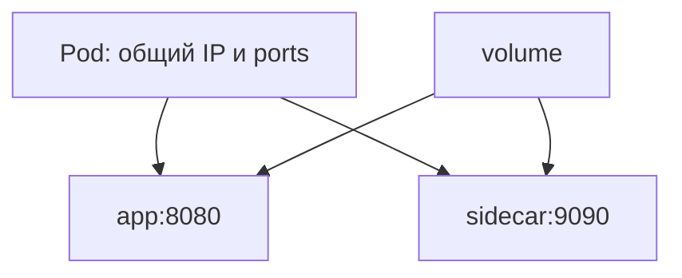

# Pod

Pod — одна единица размещения: containers вместе запускаются на одном node и делят сеть/volumes. Для обычного API их заменяемостью управляет Deployment.

Pod — smallest deployable Kubernetes unit: один или несколько tightly coupled containers с общим network namespace/IP/ports и declaratively shared volumes. Containers внутри общаются через `localhost`, но имеют отдельные process/filesystem/cgroup boundaries согласно runtime config.

Pod не durable identity. После reschedule controller создаёт новый Pod с новым UID/IP; application state храните во внешнем store/PersistentVolume и используйте Service/DNS discovery.

## Containers

- init containers выполняются до application containers последовательно;
- sidecars обслуживают logging/proxy/helper lifecycle, но добавляют resources и termination ordering;
- ephemeral containers предназначены для troubleshooting, не normal workload;
- restart policy действует через kubelet внутри Pod, а controller заменяет failed/deleted Pods.

Pod phase (`Pending/Running/Succeeded/Failed/Unknown`) грубая; container states/reasons/events дают детали. `CrashLoopBackOff` — backoff отображения повторных crashes, а не root cause.

## Scheduling и identity

Scheduler выбирает node по requests, affinity/anti-affinity, topology spread, taints/tolerations и constraints. ServiceAccount identity/token и security context задавайте явно; не используйте default privileges без необходимости.

```bash
kubectl get pod <pod> -o wide
kubectl describe pod <pod>
kubectl get pod <pod> -o yaml
```

Не создавайте naked Pod для долгоживущего сервиса: Deployment/StatefulSet/Job управляет replacement и rollout (замена экземпляров приложения новой версией).

## Один IP означает общие порты

Если app и sidecar слушают `:8080`, они конфликтуют: у Pod общее пространство портов. App на 8080 и proxy на 9090 могут общаться через localhost. Process namespace по умолчанию не обязательно общий; `shareProcessNamespace` — отдельная настройка.



Running phase не означает Ready: container может ещё не пройти probe или перезапускаться. CrashLoopBackOff — отображаемое ожидание перед повторным стартом, не отдельная phase. Для StatefulSet стабильная logical identity не превращает process memory в durable storage: PersistentVolume и restore всё равно нужны.

Обычный init container завершится до следующего; native sidecar может быть restartable init container с иным lifecycle. Проверяйте конкретную spec, не переносите последовательность обычных init на sidecars.

## Источники

- [Pods](https://kubernetes.io/docs/concepts/workloads/pods/)
- [Pod lifecycle](https://kubernetes.io/docs/concepts/workloads/pods/pod-lifecycle/)

## Проверь себя

1. Можно ли два containers Pod слушать один и тот же IP:port?
2. Чем Running отличается от Ready?

<details>
<summary>Ориентиры для ответа</summary>

1. Обычно нет, сеть общая; выбирайте разные ports или осознанный совместный bind.
2. Phase показывает грубое состояние; Ready — способность принимать трафик по conditions/probes.

</details>
