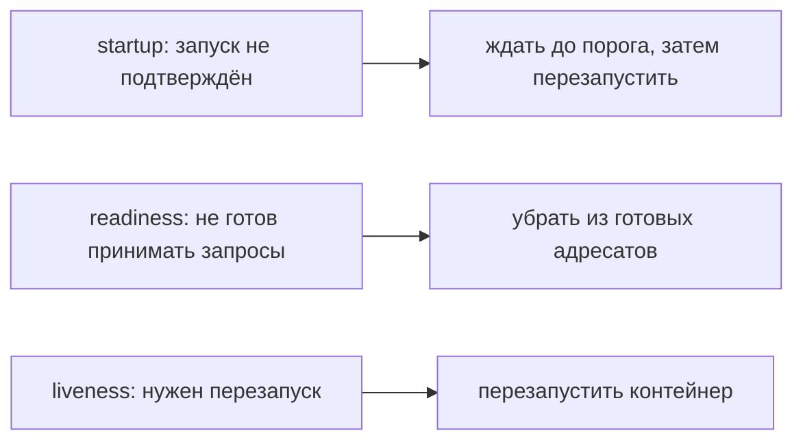

# Проверки состояния Pod

Kubernetes нужно знать три разные вещи: закончилось ли приложение запускаться, можно ли отправлять ему работу и нужен ли перезапуск. Для них существуют отдельные проверки — probes.

## Три назначения

**Startup** разрешает долгий начальный запуск; до её успеха readiness и liveness не выполняются. **Readiness** определяет готовность принимать новую работу: неудача убирает Pod из готовых адресатов Service, но не перезапускает контейнер. **Liveness** определяет состояние, в котором перезапуск полезен; её неудача запускает перезапуск.

Ниже фрагмент одного контейнера в `spec.containers[*]`. Имя порта `http` должно быть объявлено у этого контейнера в `ports`, например `name: http`, `containerPort: 8080`.

```yaml
startupProbe:
  httpGet: {path: /health/startup, port: http}
  failureThreshold: 30
  periodSeconds: 2
readinessProbe:
  httpGet: {path: /health/ready, port: http}
  periodSeconds: 5
livenessProbe:
  httpGet: {path: /health/live, port: http}
  periodSeconds: 10
  failureThreshold: 3
```

Период, срок и пороги задают время обнаружения. В примере startup с периодом 2 секунды и 30 неудачами допускает примерно 60 секунд, но это не точный срок запуска: влияет расписание и время самой проверки. Обработчик здоровья должен быть дешёвым и не создавать утечки соединений или процессов.

## Как не вызвать каскад

Если liveness выполняет `SELECT 1` в общей БД, её отказ перезапустит все Pod. Они потеряют прогретые кеши, снова откроют соединения и осложнят восстановление. Проверяйте собственное продвижение приложения, а не общую внешнюю зависимость.



БД может участвовать в readiness, только если это согласовано с допустимой деградацией. При перегрузке перевод всех Pod в неготовность оставит балансировщик без адресатов. Явное ограничение приёма с ответом `503` иногда лучше постоянных переключений готовности.

## Выбор и проверка

Открытый TCP-порт не доказывает отсутствие взаимной блокировки. Выберите HTTP, TCP или gRPC под конкретный смысл. Exec-проверка запускает процесс и может не работать в образе без нужной программы.

Отдельно наблюдайте неудачи проверок, перезапуски и задержку обработчика. Испытайте отказ зависимости и CPU throttling: проверка может не успеть из-за квоты, хотя приложение ещё способно восстановиться без перезапуска.

## Источники

- [Liveness, readiness and startup probes](https://kubernetes.io/docs/concepts/workloads/pods/probes/)

## Проверь себя

1. Перезапускает ли неудачная проверка готовности контейнер?
2. Почему общая БД обычно не должна определять liveness?

<details>
<summary>Ответы</summary>

1. Нет: меняет готовность адресата для новой работы.
2. Её отказ иначе создаст каскад перезапусков всех приложений.

</details>
