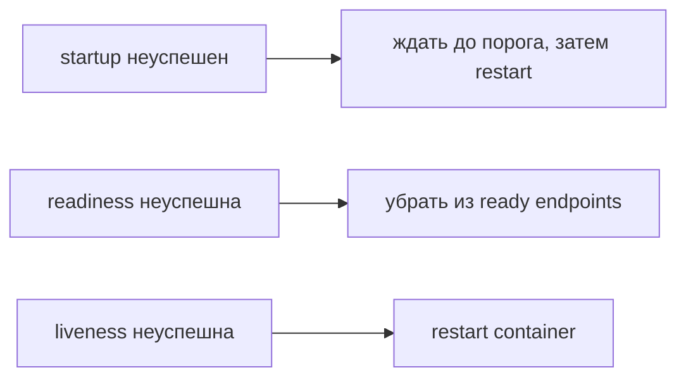

# Probes

Probe — проверка конкретного условия жизни приложения. Startup, readiness (готовность к операции или к приёму новой работы в указанном контексте) и liveness (проверка, нужен ли restart застрявшему процессу) отвечают на разные вопросы и приводят к разным действиям.

Probes отвечают на разные вопросы:

- startup: приложение завершило долгий initial start; до успеха liveness/readiness не выполняются;
- readiness: можно ли направлять новую работу; failure удаляет Pod из ready Service endpoints, но не restart-ит;
- liveness: процесс застрял необратимо и restart полезен; failure restart-ит container.

Liveness не должна зависеть от общей БД/Redis: outage dependency перезапустит все Pods, уменьшит capacity и усилит incident. Readiness тоже используйте осторожно — если все Pods unready при overload, traffic некуда направлять.

```yaml
startupProbe:
  httpGet: {path: /health/startup, port: http}
  failureThreshold: 30
  periodSeconds: 2
readinessProbe:
  httpGet: {path: /health/ready, port: http}
  periodSeconds: 5
livenessProbe:
  httpGet: {path: /health/live, port: http}
  periodSeconds: 10
  failureThreshold: 3
```

Probe timeout, period, success/failure thresholds задают detection time. Endpoint должен быть дешёвым, concurrency-safe и не создавать новый process/connection leak. Exec probe дороже и может отсутствовать в distroless image; HTTP/TCP/gRPC выбирайте по нужной semantics.

Startup budget должен покрывать worst expected cold start без скрытия вечной ошибки. Liveness проверяет progress/event loop, а не только «порт открыт», если deadlock возможен.

Наблюдайте probe failures отдельно от application 5xx, events/restarts и latency endpoint. Тестируйте dependency outage и CPU throttling (принудительное ожидание после исчерпания квоты).

## Посчитать окно и избежать каскада

В примере startup с period=2 и failureThreshold=30 допускает примерно 60 секунд неудачных проверок, с нюансами планирования и времени самой проверки. Это не точный SLA запуска. `timeoutSeconds` задайте под дешёвый health handler, а не под полный бизнес-запрос.

Если liveness делает `SELECT 1`, при падении общей DB все Pods перезапустятся. Они потеряют тёплые caches, заново создадут connections и усугубят восстановление. Liveness проверяет собственную способность продвигаться; зависимость может участвовать в readiness лишь при осознанном договоре деградации.



При overload делать все Pods unready опасно: traffic теряет адресатов. Admission control с явным 503 может быть лучше, чем постоянное переключение readiness.

## Источники

- [Liveness, readiness and startup probes](https://kubernetes.io/docs/concepts/workloads/pods/probes/)

## Проверь себя

1. Перезапускает ли failed readiness container?
2. Почему общая DB не должна определять liveness?

<details>
<summary>Ориентиры для ответа</summary>

1. Нет, меняет готовность endpoints.
2. Её отказ вызовет общий restart cascade вместо восстановления зависимости.

</details>
