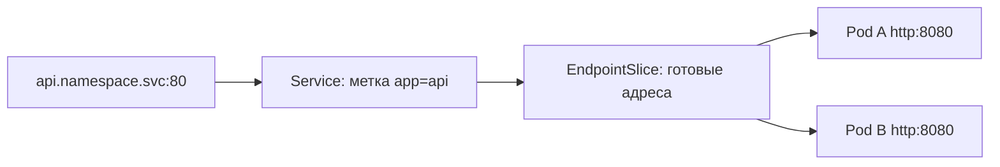

# Service

Pod меняются, а клиенту нужен устойчивый адрес. Service задаёт виртуальную точку доступа и DNS-имя для выбранных Pod. Метки выбирают получателей, готовность влияет на адресатов, а сетевой механизм перенаправляет соединения.

## Виды Service

`ClusterIP` даёт внутренний виртуальный IP. `NodePort` публикует порт узлов. `LoadBalancer` запрашивает внешнюю реализацию балансировщика у платформы. `ExternalName` создаёт DNS CNAME без обычного проксирования. Headless Service с `clusterIP: None` возвращает отдельные адреса для обнаружения клиентом.

`port` — порт Service, `targetPort` — порт или имя порта Pod, `nodePort` — внешний порт узла.

```yaml
apiVersion: v1
kind: Service
metadata: {name: api}
spec:
  selector: {app: api}
  ports:
    - {name: http, port: 80, targetPort: http}
```

Пример ищет `app=api`, принимает на 80 и направляет на порт `http`. В Deployment должна совпасть метка, а у контейнера — имя `http` для 8080. Service не выполняет собственный бизнес-запрос здоровья: готовность определяется отдельно.

## Проверить адресатов

```bash
kubectl get service api -o yaml
kubectl get endpointslice -l kubernetes.io/service-name=api
kubectl get pod -l app=api --show-labels
```

Если адресаты пусты, сначала проверьте selector, readiness и порт. Это может объяснить отказ раньше проверки DNS и внешнего TLS.



`ExternalName` лишь даёт другое DNS-имя. Клиентские Host и имя сертификата TLS должны соответствовать целевому сервису.

## Почему запросы распределяются неравномерно

Одно долгое HTTP/2-соединение может нести множество RPC к одному Pod. Равномерное распределение соединений не означает равномерного распределения запросов. Для нужного результата требуется подходящее клиентское или прикладное балансирование.

Уже открытое соединение также может продолжить работу с удаляемым Pod. Корректная остановка нужна даже после исключения из готовых адресатов.

## Источники

- [Services](https://kubernetes.io/docs/concepts/services-networking/service/)

## Проверь себя

1. Чем `port` отличается от `targetPort`?
2. Почему Service не гарантирует одинаковую нагрузку RPC?

<details>
<summary>Ответы</summary>

1. Первый принадлежит Service, второй выбирает порт Pod.
2. Много RPC могут идти по одному соединению к одному Pod.

</details>
