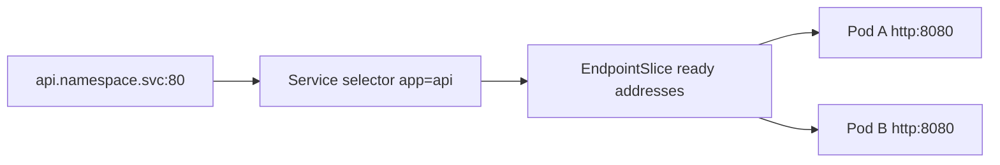

# Service

Service сохраняет имя и виртуальную точку доступа, пока Pods меняются. Labels выбирают адресатов, readiness (готовность к операции или к приёму новой работы в указанном контексте) отмечает готовность, data plane направляет соединение.

Service задаёт стабильное virtual endpoint/DNS для динамического набора Pods. Selector обычно формирует EndpointSlices из ready matching Pods; конкретный proxy/data plane реализуют kube-proxy replacement/CNI.

## Types

- `ClusterIP` — internal virtual IP (default);
- `NodePort` — port на nodes, обычно building block;
- `LoadBalancer` — просит внешнюю реализацию/provider создать LB;
- `ExternalName` — DNS CNAME, без proxy/selector;
- headless (`clusterIP: None`) — DNS возвращает individual endpoints для client-side discovery/stateful use.

`port` — Service port, `targetPort` — container/Pod port, `nodePort` — node exposure. Named ports помогают evolution.

```yaml
apiVersion: v1
kind: Service
metadata: {name: api}
spec:
  selector: {app: api}
  ports:
    - {name: http, port: 80, targetPort: http}
```

Service не проверяет application health сам: readiness влияет на ready endpoints. Existing connections могут продолжать идти в terminating Pod в зависимости от client/LB/connection; graceful shutdown всё равно нужен.

## Debug

```bash
kubectl get service api -o yaml
kubectl get endpointslice -l kubernetes.io/service-name=api
kubectl get pod -l app=api --show-labels
```

Если endpoints пусты, проверьте selector, readiness и target port прежде DNS/firewall. Service routing не гарантирует равный request load при keep-alive/HTTP2.

## Связать selector и named port

Service выше ищет `app=api`, принимает на 80 и ведёт на port с именем `http`. Deployment в соседней статье задаёт label app=api и `containerPort:8080,name:http`; эти три части должны совпадать.



Пустые endpoints означают проблему selector/готовности до проверки внешнего TLS. `ExternalName` даёт DNS alias, но клиентский Host/TLS server name может требовать согласования с целевым сервисом.

Для HTTP/2 одно долговечное соединение может нести множество RPC к одному Pod. Равномерное распределение TCP connections не гарантирует равномерность запросов; нужна соответствующая client/L7 balancing policy.

## Источники

- [Services](https://kubernetes.io/docs/concepts/services-networking/service/)

## Проверь себя

1. Что различает port и targetPort?
2. Почему Service не гарантирует равный RPC load?

<details>
<summary>Ориентиры для ответа</summary>

1. Первый относится к Service, второй к backend Pod port/name.
2. Долговечное multiplexed connection может закрепить много RPC за одним backend.

</details>
