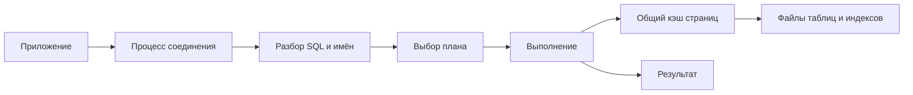

# Архитектура PostgreSQL

PostgreSQL принимает SQL, выбирает способ получения результата и читает страницы данных. Соединение обслуживается отдельным серверным процессом; тысяча соединений не означает тысячу полезно работающих запросов.

PostgreSQL использует модель «один server process на соединение». Главный `postgres` принимает подключения и создаёт backend process; фоновые процессы занимаются WAL, checkpoints, vacuum, replication и другими задачами. Это отличается от thread-per-connection серверов и делает стоимость большого числа соединений заметной.

## Путь запроса

1. Parser строит parse tree и проверяет синтаксис.
2. Analyzer связывает имена с объектами каталога и типами.
3. Rewriter применяет rules и разворачивает views.
4. Planner/optimizer оценивает допустимые планы по statistics и cost model.
5. Executor читает страницы таблиц и индексов, проверяет MVCC visibility и формирует результат.

Plan cache prepared statement может использовать custom или generic plan. Generic plan экономит planning time, но хуже учитывает конкретные значения параметров; проверяйте это через `EXPLAIN` и `plan_cache_mode`, а не предполагайте.

## Память и storage

- `shared_buffers` — общий buffer cache PostgreSQL; ОС параллельно использует page cache.
- `work_mem` задаёт лимит для отдельной sort/hash operation, а не для процесса или запроса целиком.
- `maintenance_work_mem` обслуживает maintenance operations.
- Таблица физически состоит из страницы фиксированного размера, обычно 8 KiB; строки лежат в heap, индексы — отдельные relations.
- WAL записывает изменения до dirty страницы данных и обеспечивает crash recovery.

Data directory содержит relation files, WAL, transaction status и служебные данные. Не копируйте его как обычную папку работающего сервера: backup должен обеспечивать согласованность с WAL.

## Фоновые процессы

Checkpointer ограничивает объём crash recovery, background writer сглаживает запись изменённые буферы, WAL writer пишет WAL buffers, autovacuum workers удаляют/замораживают старые версии и обновляют statistics. Для replication работают walsender/walreceiver; logical replication добавляет launcher/workers.

## Картинка: путь SELECT



Запрос по id находит адрес через индекс, читает страницу и проверяет видимость строки. Наличие страницы в памяти не отменяет проверку снимка.

```sql
SHOW block_size;
SHOW work_mem;
SELECT pid,state,wait_event_type,wait_event
FROM pg_stat_activity WHERE datname=current_database();
```

В обычной сборке block_size равен 8192; остальные значения зависят от сервера. work_mem=16MB не ограничивает весь запрос 16 MB: несколько сортировок, хеш-узлов и workers могут каждый выделять память. Для хеширования учитывается hash_mem_multiplier. Суммируйте операции, workers и одновременно активные запросы. Низкая CPU при высокой задержке может означать ожидание блокировки или клиента; добавление CPU это не устранит.

## Источники

- [PostgreSQL server architecture](https://www.postgresql.org/docs/18/tutorial-arch.html)
- [Database physical storage](https://www.postgresql.org/docs/18/storage.html)
- [Resource consumption](https://www.postgresql.org/docs/18/runtime-config-resource.html)

## Проверь себя

1. **Почему max_connections может ухудшить работу?**

   <details>
   <summary>Ответ</summary>

   Больше процессов, памяти и конкуренции за CPU/диск/блокировки без роста мощности.

   </details>

2. **Что проверить перед увеличением work_mem?**

   <details>
   <summary>Ответ</summary>

   Количество операций и workers на запрос, активных запросов и реальные spills.

   </details>
