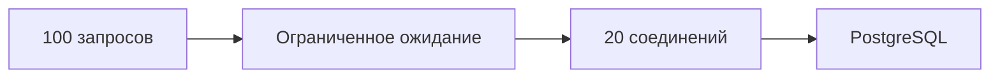

# Пул соединений

Пул хранит ограниченный набор готовых соединений. Запрос берёт свободное соединение, использует и возвращает. Когда все заняты, новый запрос ждёт или получает ошибку по сроку ожидания. Это уменьшает повторные подключения и ограничивает нагрузку на базу.

## Два места, где может находиться пул

Пул приложения, например `database/sql`, ограничивает соединения одного процесса. Внешний посредник, например PgBouncer, может распределять соединения многих приложений между меньшим числом серверных соединений.

В режиме **session pooling** клиент получает серверное соединение на всю сессию. В **transaction pooling** — только на транзакцию; следующая транзакция может попасть на другое. Поэтому установленный обычным `SET` параметр, временная таблица, подписка `LISTEN` или блокировка уровня сессии не должны считаться автоматически сохранёнными для следующей транзакции. Точную поддержку проверяют для версии посредника; `SET LOCAL` ограничивает параметр текущей транзакцией.

## Как выбрать лимит

База имеет конечную мощность. Если запросы уже конкурируют за диск или блокировку, увеличение пула добавит конкурентов, а не скорость. Считайте лимиты всех экземпляров приложения: 40 процессов по 50 соединений допускают 2000 соединений, ещё до фоновых задач и миграций. Оставьте отдельный запас для администрирования.

Начальная оценка: число операций в секунду × среднее время удержания соединения. Затем проверьте под нагрузкой очередь, задержки и насыщение базы. Среднее значение не покрывает всплески и медленные запросы автоматически.

## Четыре разных ожидания

Запрос может ждать свободное соединение, установление нового соединения, выполнение SQL или освобождение блокировки. Это разные причины задержки и разные таймауты. Измеряйте получение соединения отдельно от SQL. При отмене драйвер должен корректно завершить текущую команду или закрыть соединение, прежде чем передать его следующему запросу.

Занятый пул при низкой загрузке процессора может означать долгие транзакции или незакрытый `Rows`, а не нехватку процессорной мощности.

## Пул как ограничитель



800 операций/с × 25 ms удержания connection = 20 одновременно занятых соединений в среднем (закон Литтла). Это оценка средней занятости, не готовый размер: требуется запас и проверка saturation базы.

```go
// db — уже открытый *sql.DB; значения — пример.
db.SetMaxOpenConns(20)
db.SetMaxIdleConns(10)
db.SetConnMaxLifetime(30 * time.Minute)
s := db.Stats()
fmt.Println(s.InUse, s.WaitCount, s.WaitDuration)
```

Для фрагмента нужны импорты `fmt` и `time`. `InUse` — сейчас занятые соединения; `WaitCount` — накопленное число ожиданий; `WaitDuration` — суммарное время ожидания. Для оценки текущего интервала сравнивайте изменения счётчиков, не только их общий итог. `database/sql` по умолчанию не ограничивает `MaxOpenConns`; `pgxpool` имеет собственные значения. Суммируйте лимиты экземпляров приложения и фоновых задач. Занятые соединения при низкой загрузке процессора могут указывать на долгие транзакции или незакрытый `Rows`.

PgBouncer в режиме transaction pooling может менять серверное соединение между транзакциями. Современные версии поддерживают подготовленные запросы протокольного уровня при ненулевом `max_prepared_statements`; SQL-команды `PREPARE/DEALLOCATE` имеют другие ограничения. Не переносите гарантию одного механизма на другой. `SET LOCAL` в транзакции надёжнее ожидания сохранённого состояния сессии.

- [PgBouncer compatibility](https://www.pgbouncer.org/features.html)
- [database/sql DB](https://pkg.go.dev/database/sql#DB)

## Источники

- [PostgreSQL server architecture](https://www.postgresql.org/docs/18/tutorial-arch.html)
- [Connections and authentication settings](https://www.postgresql.org/docs/18/runtime-config-connection.html)
- [The statistics collector](https://www.postgresql.org/docs/18/monitoring-stats.html)

## Проверь себя

1. **Почему больший пул может увеличить задержку?**

   <details>
   <summary>Ответ</summary>

   Насыщенная база получает больше конкурентов; они дольше ждут диск и блокировки.

   </details>

2. **Как отличить ожидание соединения от медленного SQL?**

   <details>
   <summary>Ответ</summary>

   Измерять получение соединения отдельно, сравнивать InUse и прирост WaitDuration, затем ожидания запросов на сервере.

   </details>
