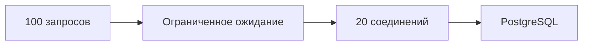

# Connection pooling

Пул — очередь к ограниченному набору соединений. Он переиспользует подключения и ограничивает число одновременно выполняемых запросов, но не увеличивает мощность базы.

Каждому прямому client connection соответствует backend process с памятью и server state. Очень высокий `max_connections` увеличивает context switching и совокупную память; pool ограничивает реальную database concurrency и повторно использует connections.

## Два уровня pool

Application pool держит ограниченное число открытых connections на process/instance. Внешний pooler может multiplex-ить много clients на меньшее число PostgreSQL sessions.

- Session pooling закрепляет server connection за client session; совместим почти со всеми session features, но multiplexing слабее.
- Transaction pooling выдаёт server connection только на время transaction; лучше multiplexing, но session state между transactions нельзя считать закреплённым.

При transaction pooling осторожны `SET` без `LOCAL`, temporary tables, session advisory locks, `LISTEN/NOTIFY`, prepared statements и другие session-scoped features — точная поддержка зависит от pooler/version/configuration.

## Настройка

Размер pool — capacity decision, а не «число CPU × магическая константа». Ограничения задают:

- допустимая active concurrency базы;
- latency и время transaction;
- число application replicas и фоновых workers;
- reserved connections для admin/migrations;
- downstream I/O и lock contention.

Суммируйте максимумы всех instances: pool 50 у 40 pods означает до 2000 connections. Небольшая bounded queue обычно лучше неограниченного открытия connections.

## Timeouts и lifecycle

Различайте timeout ожидания connection в pool, connect timeout, statement/lock timeout и context deadline запроса. При отмене SQL driver должен отправить cancel и дождаться/закрыть connection так, чтобы следующий borrower не получил незавершённый protocol state.

Наблюдайте active/idle/waiting clients, acquisition latency, connection churn, `pg_stat_activity`, transaction duration и database saturation. Pool скрывает connection setup, но не создаёт дополнительную CPU/I/O capacity.

## Пул как ограничитель



800 операций/с × 25 ms удержания connection = 20 одновременно занятых соединений в среднем (закон Литтла). Это оценка средней занятости, не готовый размер: требуется запас и проверка saturation базы.

```go
// db — уже открытый *sql.DB; значения — пример.
db.SetMaxOpenConns(20)
db.SetMaxIdleConns(10)
db.SetConnMaxLifetime(30 * time.Minute)
s := db.Stats()
fmt.Println(s.InUse, s.WaitCount, s.WaitDuration)
```

Imports: fmt, time. database/sql по умолчанию не ограничивает MaxOpenConns; pgxpool имеет свои defaults. Суммируйте лимиты pods и фоновых jobs. Низкая CPU и занятые connections могут означать долгие транзакции или забытый Rows.Close.

PgBouncer transaction pooling меняет backend между транзакциями. Protocol-level prepared statements в современных версиях поддерживаются при ненулевом max_prepared_statements; SQL PREPARE/DEALLOCATE имеет другие ограничения. SET LOCAL внутри транзакции безопаснее надежды на сохранённый session state.

- [PgBouncer compatibility](https://www.pgbouncer.org/features.html)
- [database/sql DB](https://pkg.go.dev/database/sql#DB)

## Источники

- [PostgreSQL server architecture](https://www.postgresql.org/docs/18/tutorial-arch.html)
- [Connections and authentication settings](https://www.postgresql.org/docs/18/runtime-config-connection.html)
- [The statistics collector](https://www.postgresql.org/docs/18/monitoring-stats.html)

## Проверь себя

1. **Почему увеличение pool может ухудшить latency?**

   <details>
   <summary>Ответ</summary>

   Насыщенная база получает больше конкуренции и lock contention.

   </details>

2. **Как отличить pool wait от SQL latency?**

   <details>
   <summary>Ответ</summary>

   Измерять acquisition отдельно; смотреть InUse/WaitDuration и ожидания PostgreSQL.

   </details>
