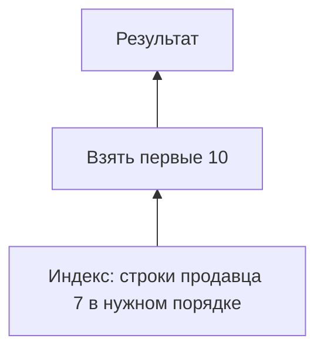

# EXPLAIN

SQL описывает нужный результат, а план показывает, **какими операциями** сервер собирается его получить. План — дерево: нижние узлы читают строки, верхние фильтруют, соединяют, сортируют и ограничивают результат.

`EXPLAIN` показывает предполагаемый план без выполнения запроса. `EXPLAIN ANALYZE` действительно выполняет его и добавляет измерения. Для `UPDATE` это настоящее изменение данных. Транзакция с `ROLLBACK` отменит обычные изменения, но не гарантирует отмену внешних действий триггера или выданного значения sequence.

## Четыре поля для первого чтения

`cost` — относительная оценка работы, не миллисекунды. `rows` без слова `actual` — ожидаемое число строк. `actual rows` — среднее число строк на одно выполнение узла. `loops` — сколько раз он выполнялся. Например, `rows=2 loops=1000` означает около 2000 полученных строк.

Читайте снизу вверх и ищите место, где сервер начал обрабатывать слишком много строк. Если ожидал 10, а получил миллион, проверьте статистику и условие. Но если верхний `Limit` остановил чтение после десяти строк, несовпадение не доказывает плохую статистику.

## Как строки попадают в результат

`Seq Scan` последовательно читает таблицу. `Index Scan` находит адреса через индекс и обращается к таблице. `Index Only Scan` пытается взять нужные данные из индекса, но иногда проверяет видимость в таблице. Пара `Bitmap Index Scan` и `Bitmap Heap Scan` сначала собирает адреса, затем группирует чтение страниц.

`Buffers: shared hit` считает обращения к уже имеющимся буферам PostgreSQL. `shared read` означает загрузку в них; данные могла отдать память ОС, поэтому это не всегда физическое чтение диска. Сортировка с использованием диска означает, что операция не поместилась в выделенную память. `Rows Removed by Filter` показывает строки, прочитанные и затем отброшенные.

## Как не получить неверное измерение

Время родительского узла включает работу дочерних, поэтому складывать времена всех узлов нельзя. Повторный запуск может использовать уже прогретый кэш. Передача результата клиенту обычно не входит в время исполнителя. Сравнивайте одинаковые данные и параметры и проверяйте задержку приложения отдельно. `TIMING OFF` уменьшает накладные расходы измерения, сохраняя фактические строки и буферы.

## Данные, запрос и чтение плана

```sql
CREATE TABLE explain_ads(
    id integer PRIMARY KEY,seller_id integer NOT NULL,
    created_at timestamptz NOT NULL,title text NOT NULL
);
INSERT INTO explain_ads
SELECT n,n%1000,timestamptz '2026-01-01 UTC'+n*interval '1 minute',
       'Объявление '||n FROM generate_series(1,100000) AS n;
CREATE INDEX explain_ads_seller_feed
ON explain_ads(seller_id,created_at DESC,id DESC);
ANALYZE explain_ads;
EXPLAIN (ANALYZE,BUFFERS)
SELECT id,title FROM explain_ads WHERE seller_id=7
ORDER BY created_at DESC,id DESC LIMIT 10;
```

Вероятна форма Limit → Index Scan. Ниже **учебные числа**, не результаты измерения:

```text
Limit (cost=... rows=10) (actual time=0.03..0.10 rows=10 loops=1)
  -> Index Scan using explain_ads_seller_feed
     (cost=... rows=100) (actual time=0.03..0.09 rows=10 loops=1)
       Index Cond: (seller_id = 7)
       Buffers: shared hit=13
```

Планировщик ожидает около 100 строк продавца, но `Limit` останавливает чтение после 10. Поэтому фактические 10 здесь не доказывают ошибку оценки. Индекс уже задаёт порядок, отдельная сортировка не нужна. `shared hit=13` означает 13 обращений к готовым буферам, не обязательно 13 разных страниц.



В параллельном плане отдельно учитывайте работу исполнителей: она может перекрываться во времени. Для меньших накладных расходов измерения доступен `TIMING OFF`, сохраняющий фактические строки и сведения о буферах.

## Источники

- [Using EXPLAIN](https://www.postgresql.org/docs/18/using-explain.html)
- [EXPLAIN command](https://www.postgresql.org/docs/18/sql-explain.html)

## Проверь себя

1. **Всегда ли фактических строк меньше ожидаемых означает плохую статистику?**

   <details>
   <summary>Ответ</summary>

   Нет. Например, Limit может остановить чтение после первых десяти из ста подходящих строк.

   </details>

2. **Почему нельзя складывать actual time всех узлов?**

   <details>
   <summary>Ответ</summary>

   Время родителя включает детей, значения усредняются по loops; параллельная работа может перекрываться.

   </details>
