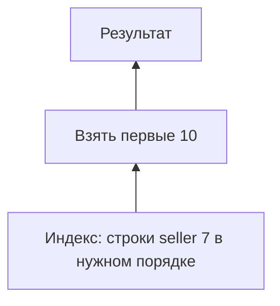

# EXPLAIN

План — дерево операций: где взять строки, как соединить, отфильтровать и отсортировать. EXPLAIN показывает предположение, ANALYZE добавляет наблюдения реального выполнения.

`EXPLAIN` показывает план без выполнения. `EXPLAIN ANALYZE` выполняет statement и добавляет фактические метрики; для изменяющего запроса используйте явную transaction с `ROLLBACK`, помня, что triggers и внешние side effects могут всё равно сработать.

```sql
BEGIN;
EXPLAIN (ANALYZE, BUFFERS, WAL, SETTINGS, FORMAT TEXT)
UPDATE jobs SET attempts = attempts + 1 WHERE id = 42;
ROLLBACK;
```

## Как читать

Начинайте с фактического потока данных снизу вверх:

- `cost=startup..total` и `rows` — estimates planner;
- `actual time`, `rows`, `loops` — наблюдение одного запуска;
- общее число строк узла приблизительно `rows × loops`;
- `Buffers: shared hit/read/dirtied/written` отделяет cache hits от reads и writes;
- `Rows Removed by Filter` показывает позднюю фильтрацию;
- sort method, memory и disk usage выявляют spills;
- `WAL` помогает оценить write amplification.

Главный сигнал — не «использован ли индекс», а где фактический объём/время возникли и почему estimates неверны. Sequential scan малой таблицы или большой доли данных часто оптимален.

## Частые scan nodes

- `Seq Scan` читает table pages последовательно.
- `Index Scan` находит TIDs в индексе и читает heap.
- `Index Only Scan` может вернуть payload из индекса, но зависит от visibility map.
- `Bitmap Index Scan` + `Bitmap Heap Scan` группирует heap accesses и удобен для средней selectivity или объединения indexes.

## Осторожность измерения

`ANALYZE` добавляет instrumentation overhead; первый и повторный запуск имеют разный cache state. Клиентская передача результата обычно не включена в executor time. Сравнивайте одинаковые данные/параметры, несколько запусков и latency приложения.

В production сначала используйте `EXPLAIN` без `ANALYZE` для опасного statement или снимок из `pg_stat_statements`. Никогда не запускайте тяжёлый `EXPLAIN ANALYZE` вслепую.

## Данные, запрос и чтение плана

```sql
CREATE TABLE explain_ads(
    id integer PRIMARY KEY,seller_id integer NOT NULL,
    created_at timestamptz NOT NULL,title text NOT NULL
);
INSERT INTO explain_ads
SELECT n,n%1000,timestamptz '2026-01-01 UTC'+n*interval '1 minute',
       'Объявление '||n FROM generate_series(1,100000) AS n;
CREATE INDEX explain_ads_seller_feed
ON explain_ads(seller_id,created_at DESC,id DESC);
ANALYZE explain_ads;
EXPLAIN (ANALYZE,BUFFERS)
SELECT id,title FROM explain_ads WHERE seller_id=7
ORDER BY created_at DESC,id DESC LIMIT 10;
```

Вероятна форма Limit → Index Scan. Ниже **учебные числа**, не результаты измерения:

```text
Limit (cost=... rows=10) (actual time=0.03..0.10 rows=10 loops=1)
  -> Index Scan using explain_ads_seller_feed
     (cost=... rows=100) (actual time=0.03..0.09 rows=10 loops=1)
       Index Cond: (seller_id = 7)
       Buffers: shared hit=13
```

Ожидается около 100 строк клиента, но Limit прекращает чтение на 10; это не ошибка оценки. shared hit считает обращения к буферам, не обязательно уникальные страницы. shared read означает загрузку в PostgreSQL: ОС могла обслужить её из своего кэша.



rows=2 loops=1000 означает примерно 2000 строк. Время включает дочерние узлы и усредняется по loops, поэтому складывать времена дерева нельзя. В параллельном плане учитывайте workers. TIMING OFF уменьшает инструментирование, сохраняя фактические rows/buffers.

## Источники

- [Using EXPLAIN](https://www.postgresql.org/docs/18/using-explain.html)
- [EXPLAIN command](https://www.postgresql.org/docs/18/sql-explain.html)

## Проверь себя

1. **Когда rows estimate против actual не означает плохую статистику?**

   <details>
   <summary>Ответ</summary>

   Если родитель Limit или semi-join остановил чтение раньше.

   </details>

2. **Почему нельзя складывать actual time?**

   <details>
   <summary>Ответ</summary>

   Времена вложены, усредняются по loops; параллельные операции перекрываются.

   </details>
