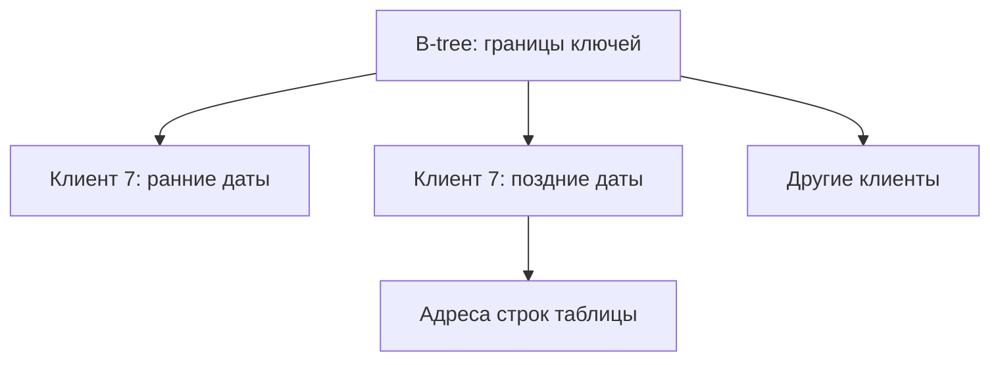

# Индексы PostgreSQL

Индекс — дополнительная структура для поиска строк. Как предметный указатель книги, он позволяет перейти к нужному месту без чтения всего содержимого. Но указатель занимает место и должен меняться вместе с таблицей.

## Как выбрать подходящий тип

| Тип | Что помогает найти |
| --- | --- |
| B-tree | Равенство, диапазон и порядок: id=7, цена от 100 до 200, последние даты |
| Hash | Равенство; преимущества перед B-tree нужно измерять |
| GIN | Элемент внутри массива, поля JSON или слова текста |
| GiST | Диапазоны, геометрические и ближайшие объекты при подходящей реализации |
| SP-GiST | Данные, которые удобно делить на области или префиксы |
| BRIN | Диапазоны страниц большой таблицы, где близкие значения лежат рядом физически |

Поддерживаемые сравнения задаёт **класс операторов** (operator class). Названия типа недостаточно: индекс должен поддерживать условие запроса.

## Почему порядок колонок важен

В индексе `(customer_id, created_at DESC, id DESC)` записи сначала сгруппированы по клиенту, затем по дате и id. Для списка заказов одного клиента сервер сразу получает его диапазон в нужном порядке. Поиск только по дате сложнее: она перемешана между группами клиентов. PostgreSQL 18 может использовать skip scan — перебор подходящих групп — но при множестве разных клиентов он может оказаться дорогим.

Индекс выражения `lower(email)` помогает запросу по этому выражению. Частичный индекс `WHERE status='ready'` хранит только готовые задачи; планировщик должен доказать, что запрос ищет именно этот набор. Параметр с неизвестным значением может мешать доказательству.

`INCLUDE(status)` сохраняет дополнительную колонку для чтения из индекса. Она не участвует в поиске и уникальности. Даже покрывающий индекс не всегда избавляет от таблицы: серверу нужно знать, что все версии на странице видны текущим читателям. Это отмечается в карте видимости после обслуживания.

## Когда индекс мешает

Если условию подходит большая часть таблицы, последовательное чтение может быть дешевле переходов по адресам строк. Каждый индекс добавляет работу при изменении, расход кэша и журнала WAL. Смотрите реальные планы, размеры и счётчики использования. Нулевой счётчик после перезапуска не доказывает ненужность индекса; индекс также может защищать ограничение уникальности.

## Индекс под конкретный запрос



Упрощённая иллюстрация диапазона, не реальные страницы B-tree.

```sql
CREATE TABLE index_orders(
    id bigint PRIMARY KEY,customer_id bigint NOT NULL,
    created_at timestamptz NOT NULL,status text NOT NULL
);
INSERT INTO index_orders VALUES
(1,7,'2026-10-01 UTC','paid'),(2,7,'2026-10-02 UTC','new'),
(3,8,'2026-10-03 UTC','paid');
CREATE INDEX index_orders_feed
ON index_orders(customer_id,created_at DESC,id DESC) INCLUDE(status);
SELECT id,status FROM index_orders WHERE customer_id=7
ORDER BY created_at DESC,id DESC LIMIT 2;
-- (2,new), (1,paid)
```

Равенство клиента ограничивает группу ключей; дата даёт готовый порядок. На трёх строках Seq Scan может быть дешевле. Запрос только по дате не получает ту же эффективность: B-tree skip scan PostgreSQL 18 перебирает группы, а при большом числе клиентов это дорого.

Уникальность пары защищает сочетание значений, а не каждую колонку отдельно. Обычное ограничение допускает несколько `NULL`; `NULLS NOT DISTINCT` позволяет считать их одинаковыми. Внешний ключ не создаёт индекс на ссылающейся стороне автоматически. `CREATE INDEX CONCURRENTLY` уменьшает блокирование записей ценой дополнительной работы, не выполняется внутри обычного блока транзакции и после неудачи может оставить непригодный индекс, который нужно проверить и обслужить.

## Индекс результата выражения и части таблицы

Самостоятельный пример поиска почты без различия регистра:

```sql
CREATE TABLE index_users(id integer PRIMARY KEY,email text NOT NULL);
INSERT INTO index_users VALUES (1,'Alice@example.test'),(2,'bob@example.test');
CREATE INDEX index_users_email_lower ON index_users(lower(email));
SELECT id FROM index_users WHERE lower(email)='alice@example.test';
```

Запрос возвращает 1, потому что и ключ индекса, и условие используют `lower(email)`. Обычный индекс по `email` хранит другое значение. Это пример выбранного правила сравнения, а не универсальная нормализация адресов. Индекс выражения требует вычислять ключ при изменениях; функции в его определении должны удовлетворять требованиям PostgreSQL к неизменяемости результата.

Частичный индекс сохраняет только готовые задачи. Следующий блок независим от таблицы пользователей:

```sql
CREATE TABLE index_jobs(id integer PRIMARY KEY,status text NOT NULL);
INSERT INTO index_jobs VALUES (1,'done'),(2,'ready'),(3,'ready');
CREATE INDEX index_jobs_ready ON index_jobs(id) WHERE status='ready';
SELECT id FROM index_jobs WHERE status='ready' ORDER BY id LIMIT 1;
```

Возвращается 2: задача 1 не готова и не входит в этот индекс. Условие запроса явно гарантирует принадлежность строк индексируемому набору. Поиск `status='done'` этим индексом не обслуживается. Если общий подготовленный план видит `status=$1` без значения, он не может доказать, что параметр всегда равен `ready`. На трёх строках сервер вправе выбрать последовательное чтение: пример показывает пригодность индекса, а не обещает конкретный план.

## Источники

- [Indexes](https://www.postgresql.org/docs/18/indexes.html)
- [Index types](https://www.postgresql.org/docs/18/indexes-types.html)
- [Index-only scans and covering indexes](https://www.postgresql.org/docs/18/indexes-index-only-scans.html)

- [Дополнительная документация PostgreSQL 18](https://www.postgresql.org/docs/18/indexes-multicolumn.html)

- [Индексы выражений](https://www.postgresql.org/docs/18/indexes-expressional.html)
- [Частичные индексы](https://www.postgresql.org/docs/18/indexes-partial.html)

## Проверь себя

1. **Почему маленькая таблица прочитана без индекса?**

   <details>
   <summary>Ответ</summary>

   Последовательное чтение нескольких страниц дешевле обхода индекса и отдельных обращений к строкам.

   </details>

2. **Достаточно ли INCLUDE для полного чтения из индекса?**

   <details>
   <summary>Ответ</summary>

   Нет. Нужна также информация о видимости страниц; иначе сервер обращается к таблице. Проверяйте Heap Fetches.

   </details>
