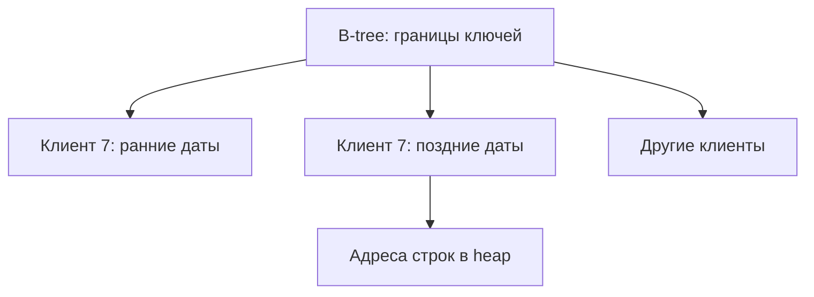

# Индексы PostgreSQL

Индекс — структура для быстрого поиска адресов строк. Как указатель книги, он сокращает поиск, но занимает место и должен обновляться вместе с данными.

Индекс ускоряет часть чтений ценой дополнительного места, WAL, random I/O и работы при `INSERT`, `UPDATE`, `DELETE` и vacuum. Создавайте его под форму запроса и подтверждайте пользу через [EXPLAIN](explain.md) и production statistics.

## Основные типы

| Тип | Типичная задача |
| --- | --- |
| B-tree | equality, ranges, sorting, prefix/pattern при подходящей operator class |
| Hash | только equality; редко даёт преимущество перед B-tree |
| GIN | составные значения: arrays, `jsonb`, full-text; быстрая проверка membership, дорогая запись |
| GiST | extensible search tree: ranges, geometry, nearest-neighbor в подходящих opclasses |
| SP-GiST | partitioned search structures: tries, quadtrees и подходящие non-balanced data |
| BRIN | компактное summary по block ranges; выгоден для очень больших физически коррелированных данных |

Тип сам по себе ничего не гарантирует: доступные operators задаёт operator class.

## Составные индексы и порядок колонок

```sql
CREATE INDEX orders_customer_created_idx
ON orders (customer_id, created_at DESC, id DESC);
```

B-tree наиболее эффективен, когда ограничения на leading columns сокращают scan. Равенства слева и затем range/order — полезная отправная точка, но не механическое правило. PostgreSQL может применить skip scan или использовать часть индекса, однако стоимость зависит от числа distinct values и statistics.

## Специализированные варианты

```sql
CREATE INDEX users_lower_email_idx ON users (lower(email));

CREATE INDEX jobs_ready_idx ON jobs (priority, id)
WHERE status = 'ready';

CREATE INDEX orders_lookup_idx ON orders (customer_id, created_at)
INCLUDE (status, total);
```

- Expression index помогает только когда выражение запроса совпадает по смыслу с индексируемым.
- Partial index мал и дешёв, но planner должен доказать, что predicate запроса влечёт predicate индекса; произвольный parameterized clause может этому мешать.
- `INCLUDE` хранит payload для index-only scan, но included columns не участвуют в поиске/uniqueness и увеличивают индекс.
- Index-only scan также требует all-visible bit для heap page; иначе executor проверяет heap.

## Избирательность, количество строк и цена

Cardinality — число строк или distinct values; selectivity — доля строк, удовлетворяющая условию. Низкая selectivity часто делает sequential scan дешевле множества heap fetches. Correlation физического порядка с ключом влияет на стоимость range scan.

Слишком много индексов:

- усиливает WAL и write latency;
- снижает шанс HOT update;
- расходует cache и disk;
- удлиняет vacuum и recovery;
- может bloating при churn.

Смотрите `pg_stat_user_indexes`, размер через `pg_relation_size`, реальные планы и write profile. Не удаляйте индекс только из-за нулевого счётчика после недавнего restart или если он поддерживает constraint.

## Индекс под конкретный запрос



Упрощённая иллюстрация диапазона, не реальные страницы B-tree.

```sql
CREATE TABLE index_orders(
    id bigint PRIMARY KEY,customer_id bigint NOT NULL,
    created_at timestamptz NOT NULL,status text NOT NULL
);
INSERT INTO index_orders VALUES
(1,7,'2026-10-01 UTC','paid'),(2,7,'2026-10-02 UTC','new'),
(3,8,'2026-10-03 UTC','paid');
CREATE INDEX index_orders_feed
ON index_orders(customer_id,created_at DESC,id DESC) INCLUDE(status);
SELECT id,status FROM index_orders WHERE customer_id=7
ORDER BY created_at DESC,id DESC LIMIT 2;
-- (2,new), (1,paid)
```

Равенство клиента ограничивает группу ключей; дата даёт готовый порядок. На трёх строках Seq Scan может быть дешевле. Запрос только по дате не получает ту же эффективность: B-tree skip scan PostgreSQL 18 перебирает группы, а при большом числе клиентов это дорого.

Unique на паре защищает пару, не отдельные поля. Nullable unique по умолчанию допускает несколько NULL; иной смысл выражает NULLS NOT DISTINCT. Foreign key не создаёт индекс на ссылающейся стороне автоматически. CREATE INDEX CONCURRENTLY делает больше работы, не допускается в transaction block и после неудачи может оставить invalid index.

## Источники

- [Indexes](https://www.postgresql.org/docs/18/indexes.html)
- [Index types](https://www.postgresql.org/docs/18/indexes-types.html)
- [Index-only scans and covering indexes](https://www.postgresql.org/docs/18/indexes-index-only-scans.html)

- [Дополнительная документация PostgreSQL 18](https://www.postgresql.org/docs/18/indexes-multicolumn.html)

## Проверь себя

1. **Почему маленькая таблица читалась без индекса?**

   <details>
   <summary>Ответ</summary>

   Seq Scan дешевле навигации и heap fetches.

   </details>

2. **Достаточно INCLUDE для index-only scan без heap?**

   <details>
   <summary>Ответ</summary>

   Нужна ещё видимость страницы по visibility map; проверять Heap Fetches.

   </details>
