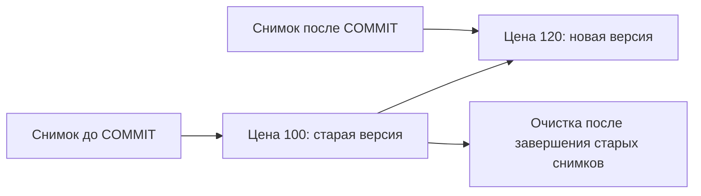

# MVCC

Два клиента могут одновременно читать и менять одну строку. PostgreSQL не заставляет обычного читателя ждать каждого писателя: сохраняет версии и выбирает подходящую для чтения. Это **многоверсионное управление конкурентным доступом**, MVCC.

## Как появляется вторая версия

Если цена была 100, а `UPDATE` меняет её на 120, старая версия не исчезает сразу. Читатель состояния до изменения продолжает видеть 100. Новый читатель после сохранения может увидеть 120. Снимок — правила выбора видимых версий, а не полная копия таблицы.

У версии есть служебные сведения: `xmin` указывает создавшую транзакцию, `xmax` связан с удалением, заменой или блокировкой. Сервер учитывает и состояние транзакций. Поэтому сравнения этих чисел недостаточно для собственного протокола приложения.

## Когда старую версию можно убрать

Старая версия нужна, пока существует читатель, которому она ещё видна. После этого [VACUUM](vacuum.md) освобождает её место для повторного использования. Долго удерживаемый снимок задерживает очистку: таблица и индексы растут, хотя живых данных мало.

Не любая открытая транзакция удерживает один снимок постоянно. В Read Committed снимок обычно действует на время команды; в Repeatable Read сохраняется дольше. Смотрите возраст транзакций и `backend_xmin`, а также слоты репликации и подготовленные транзакции.

## Как снизить стоимость обновлений

Обычно новая версия требует новых записей в индексах. Оптимизация **HOT** позволяет обойтись без них, если поля обычных индексов не изменились и версия помещается на той же странице. Свободное место оставляют параметром `fillfactor`, но выгоду проверяют на нагрузке. Суммирующие индексы, например BRIN в PostgreSQL 18, имеют отдельные правила.

MVCC не делает любой доступ неблокирующим: `SELECT FOR UPDATE`, DDL и конкурирующие записи всё ещё имеют [блокировки](locks.md).

## Два читателя и две версии



```sql
CREATE TABLE mvcc_demo(id integer PRIMARY KEY,price integer NOT NULL);
INSERT INTO mvcc_demo VALUES (1,100);
```

| Шаг | Соединение A | Соединение B |
| --- | --- | --- |
| 1 | BEGIN ISOLATION LEVEL REPEATABLE READ | |
| 2 | SELECT price FROM mvcc_demo WHERE id=1 → 100 | |
| 3 | | UPDATE mvcc_demo SET price=120 WHERE id=1 (autocommit) |
| 4 | Повтор SELECT → 100 | |
| 5 | COMMIT; новый SELECT → 120 | |

При Read Committed шаг 4 покажет 120. Если A в Repeatable Read пытается обновить эту строку после шага 3, возможен 40001: она изменилась после снимка.

В A выбран Repeatable Read, поэтому второй SELECT остаётся на снимке с ценой 100. После COMMIT новый запрос получает актуальное состояние 120. Если вместо этого A начнёт изменять уже обновлённую B строку, конфликт снимка может привести к ошибке `40001` и необходимости повторить транзакцию.

## Источники

- [MVCC introduction](https://www.postgresql.org/docs/18/mvcc-intro.html)
- [Routine vacuuming](https://www.postgresql.org/docs/18/routine-vacuuming.html)
- [System columns](https://www.postgresql.org/docs/18/ddl-system-columns.html)

- [Дополнительная документация PostgreSQL 18](https://www.postgresql.org/docs/18/storage-hot.html)

## Проверь себя

1. **Делает ли MVCC SELECT FOR UPDATE неблокирующим?**

   <details>
   <summary>Ответ</summary>

   Нет. Это явное блокирующее чтение, отличное от обычного SELECT.

   </details>

2. **Почему DELETE не освобождает всё место сразу?**

   <details>
   <summary>Ответ</summary>

   Старую версию ещё может видеть снимок. После этого VACUUM делает её место пригодным для повторного использования.

   </details>
