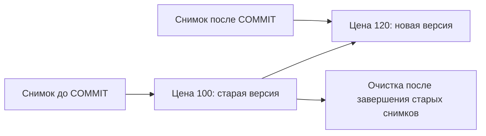

# MVCC

MVCC хранит несколько версий строки. Читатель выбирает подходящую по снимку состояния, а писатель создаёт новую. Снимок — правила видимости, не полная копия таблицы.

Multi-Version Concurrency Control позволяет читателям видеть согласованный snapshot, пока другие транзакции создают новые версии строк. Поэтому обычный `SELECT` обычно не блокирует `UPDATE`, а `UPDATE` — обычный `SELECT`; исключения связаны с DDL, явные блокировки и другими конфликтами.

## Версии и видимость

`UPDATE` обычно не переписывает tuple на месте: он помечает старую версию и создаёт новую. Концептуально системные поля означают:

- `xmin` — ID транзакции, создавшей версию;
- `xmax` — ID транзакции, удалившей/заменившей её либо участвующей в row locking;
- snapshot — множество границ и активных идентификаторы транзакций, по которым определяется видимость.

Одних чисел `xmin/xmax` недостаточно: сервер также учитывает состояние транзакций и hint bits. Не стройте прикладной протокол на системных колонках — их смысл содержит внутренние детали.

## Мёртвые версии и VACUUM

Старая версия не удаляется сразу: она может быть видна старому snapshot. Когда она больше никому не нужна, `VACUUM` освобождает место для повторного использования; autovacuum автоматизирует cleanup, freeze и `ANALYZE`. Обычный `VACUUM` обычно не возвращает место ОС, а `VACUUM FULL` переписывает таблицу и берёт `ACCESS EXCLUSIVE` lock.

Долгая или забытая `idle in transaction` транзакция удерживает старый snapshot. Результат — накопление dead tuples, index/table bloat, рост WAL и риск transaction ID wraparound. Наблюдайте `pg_stat_activity`, `pg_stat_all_tables`, возраст `relfrozenxid` и прогресс vacuum.

## HOT updates

Heap-only tuple update может не создавать новые index entries, если столбцы, используемые обычными индексами, не изменились и новая версия помещается на той же heap page; summarizing indexes имеют исключение. Это уменьшает write amplification, но зависит от свободного места (`fillfactor`) и фактической нагрузки.

## Два читателя и две версии



```sql
CREATE TABLE mvcc_demo(id integer PRIMARY KEY,price integer NOT NULL);
INSERT INTO mvcc_demo VALUES (1,100);
```

| Шаг | Соединение A | Соединение B |
| --- | --- | --- |
| 1 | BEGIN ISOLATION LEVEL REPEATABLE READ | |
| 2 | SELECT price FROM mvcc_demo WHERE id=1 → 100 | |
| 3 | | UPDATE mvcc_demo SET price=120 WHERE id=1 (autocommit) |
| 4 | Повтор SELECT → 100 | |
| 5 | COMMIT; новый SELECT → 120 | |

При Read Committed шаг 4 покажет 120. Если A в Repeatable Read пытается обновить эту строку после шага 3, возможен 40001: она изменилась после снимка.

Долгий снимок удерживает версии. Не любая открытая транзакция постоянно держит один снимок: в Read Committed он обычно действует на время команды. Диагностируйте backend_xmin, открытые транзакции, слоты и prepared transactions. Для HOT правило о неизменности индексируемых столбцов имеет исключение: summarizing indexes, например BRIN в PostgreSQL 18, не препятствуют HOT по тем же правилам, что обычный B-tree.

## Источники

- [MVCC introduction](https://www.postgresql.org/docs/18/mvcc-intro.html)
- [Routine vacuuming](https://www.postgresql.org/docs/18/routine-vacuuming.html)
- [System columns](https://www.postgresql.org/docs/18/ddl-system-columns.html)

- [Дополнительная документация PostgreSQL 18](https://www.postgresql.org/docs/18/storage-hot.html)

## Проверь себя

1. **Делает ли MVCC SELECT FOR UPDATE неблокирующим?**

   <details>
   <summary>Ответ</summary>

   Нет, обычное чтение и явное блокирующее чтение различаются.

   </details>

2. **Почему DELETE не освобождает всё место сразу?**

   <details>
   <summary>Ответ</summary>

   Старая версия может требоваться снимку; затем VACUUM освобождает место для reuse.

   </details>
