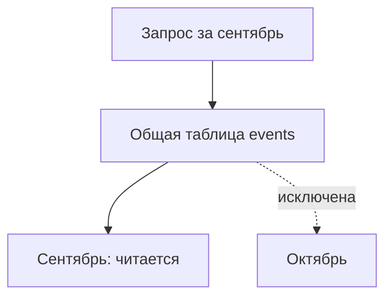

# Партиционирование

Партиционирование делит таблицу на физические части. Например, события сентября и октября лежат отдельно, но SQL обращается к общей `events`. Если нужен сентябрь, сервер может исключить октябрьскую часть до чтения. Это исключение называется **pruning**.

## Что становится удобнее

Старый месяц можно удалить целиком вместо миллионов `DELETE`. У частей меньше собственные индексы и объём обслуживания. Кроме разделения по диапазону существуют разделение по списку значений и по хешу.

Ускорение возникает там, где запрос позволяет исключить части. Условие по времени в диапазоне `[начало,конец)` обычно яснее, чем `date(occurred_at)`. Проверяйте список читаемых частей и `Subplans Removed` в `EXPLAIN`.

## Какие обязанности добавляются

Части создают заранее, правильно задавая часовой пояс и границы. Если подходящей части нет, вставка может завершиться ошибкой. Слишком много частей увеличивает время планирования и память. Изменение ключа разделения может переносить строку; присоединение и отсоединение частей требует блокировок.

Уникальность общей таблицы поддерживается локальными индексами, поэтому ограничение должно включать все колонки ключа разделения. Уникальный id без временного ключа для месячных частей нельзя автоматически защитить таким ограничением: нужна другая схема или реестр идентификаторов.

Изменения дочерних таблиц сами по себе не запускают `ANALYZE` родителя через autovacuum. Планируйте его статистику отдельно. Размер частей выбирают по запросам, хранению и обслуживанию.

Части могут оставаться на одном сервере: мощность другого сервера не добавилась. Распределение по разным серверам называется **шардингом** и решает другую задачу.

```sql
SET TIME ZONE 'UTC';
CREATE TABLE events (
    tenant_id bigint NOT NULL,
    occurred_at timestamptz NOT NULL,
    payload jsonb NOT NULL
) PARTITION BY RANGE (occurred_at);
CREATE TABLE events_2026_09 PARTITION OF events
FOR VALUES FROM ('2026-09-01') TO ('2026-10-01');
```

Это общая таблица и первая месячная часть. В примере ниже добавляется октябрьская.

## Проверить pruning

Для events из примера выше:

```sql
CREATE TABLE events_2026_10 PARTITION OF events
FOR VALUES FROM ('2026-10-01') TO ('2026-11-01');
INSERT INTO events VALUES (7,'2026-09-20 UTC','{"kind":"created"}');
EXPLAIN SELECT * FROM events
WHERE occurred_at>=timestamptz '2026-09-01 UTC'
  AND occurred_at<timestamptz '2026-10-01 UTC';
```

Ожидается чтение сентябрьской части; план зависит от среды. Для временных границ фиксируйте timezone создания partitions. Полуоткрытый диапазон [from,to) проще использует ключ, чем обёртка date(occurred_at).



UNIQUE(id) на таблице, разбитой по времени, не обеспечивается локальными индексами без ключа partitioning. Отдельный реестр ключей или другая схема должны явно защищать требуемое правило. Вероятная уникальность UUID не заменяет constraint. Partitioning на одном сервере не добавляет CPU другого сервера: это не sharding. Attach может проверять все строки; подходящий CHECK помогает доказать границы.

## Источники

- [Table partitioning](https://www.postgresql.org/docs/18/ddl-partitioning.html)
- [CREATE TABLE](https://www.postgresql.org/docs/18/sql-createtable.html)

## Проверь себя

1. **Почему разделение таблицы на части не является шардингом?**

   <details>
   <summary>Ответ</summary>

   Части могут находиться на том же сервере и не добавляют мощность других узлов.

   </details>

2. **Как проверить исключение ненужных частей?**

   <details>
   <summary>Ответ</summary>

   EXPLAIN показывает читаемые части и Subplans Removed, если части исключаются во время выполнения.

   </details>
