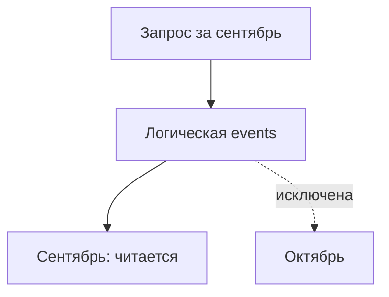

# Партиционирование

Партиционирование делит одну таблицу на физические части, например месяцы. SQL обращается к общей таблице, а сервер может не читать заведомо неподходящие части.

Declarative partitioning делит одну logical table на physical partitions по range, list или hash key. Оно полезно, когда queries/retention действительно совпадают с ключом, а не как автоматический способ «ускорить большую таблицу».

```sql
SET TIME ZONE 'UTC';
CREATE TABLE events (
    tenant_id bigint NOT NULL,
    occurred_at timestamptz NOT NULL,
    payload jsonb NOT NULL
) PARTITION BY RANGE (occurred_at);

CREATE TABLE events_2026_09 PARTITION OF events
FOR VALUES FROM ('2026-09-01') TO ('2026-10-01');
```

## Pruning

Planner/executor исключает partitions, границы которых несовместимы с predicate. Predicate должен быть выражен через partition key так, чтобы pruning мог его использовать; cast/function и generic parameter plan иногда ухудшают результат. Проверяйте `EXPLAIN` и `Subplans Removed`, а не только наличие clause.

## Польза

- быстрый retention через detach/drop partition вместо массового `DELETE`;
- smaller local indexes и vacuum domains;
- pruning больших диапазонов;
- разные tablespaces/settings для жизненного цикла данных.

## Цена и ограничения

- нужно заранее создавать/прикреплять partitions и обрабатывать default partition;
- слишком много partitions увеличивает planning time и memory;
- unique/primary constraint на partitioned table должен включать все partition key columns, чтобы уникальность можно было обеспечить локальными indexes;
- cross-partition `UPDATE` фактически перемещает row;
- schema/index changes и `ATTACH/DETACH` имеют lock implications;
- autovacuum не выполняет `ANALYZE` partitioned parent автоматически только из-за изменений children — планируйте обновление parent statistics.

Подбирайте granularity по retention, объёму, query predicates и operational cadence. «Одна partition на tenant» плохо масштабируется при тысячах tenants; hash subpartitioning тоже добавляет управление.

## Проверить pruning

Для events из примера выше:

```sql
CREATE TABLE events_2026_10 PARTITION OF events
FOR VALUES FROM ('2026-10-01') TO ('2026-11-01');
INSERT INTO events VALUES (7,'2026-09-20 UTC','{"kind":"created"}');
EXPLAIN SELECT * FROM events
WHERE occurred_at>=timestamptz '2026-09-01 UTC'
  AND occurred_at<timestamptz '2026-10-01 UTC';
```

Ожидается чтение сентябрьской части; план зависит от среды. Для временных границ фиксируйте timezone создания partitions. Полуоткрытый диапазон [from,to) проще использует ключ, чем обёртка date(occurred_at).



UNIQUE(id) на таблице, разбитой по времени, не обеспечивается локальными индексами без ключа partitioning. Отдельный реестр ключей или другая схема должны явно защищать требуемое правило. Вероятная уникальность UUID не заменяет constraint. Partitioning на одном сервере не добавляет CPU другого сервера: это не sharding. Attach может проверять все строки; подходящий CHECK помогает доказать границы.

## Источники

- [Table partitioning](https://www.postgresql.org/docs/18/ddl-partitioning.html)
- [CREATE TABLE](https://www.postgresql.org/docs/18/sql-createtable.html)

## Проверь себя

1. **Почему partitioning не sharding?**

   <details>
   <summary>Ответ</summary>

   Части могут оставаться на одном сервере, ресурсы разных узлов не появились.

   </details>

2. **Как проверить pruning?**

   <details>
   <summary>Ответ</summary>

   EXPLAIN показывает использованные части и Subplans Removed для runtime pruning.

   </details>
